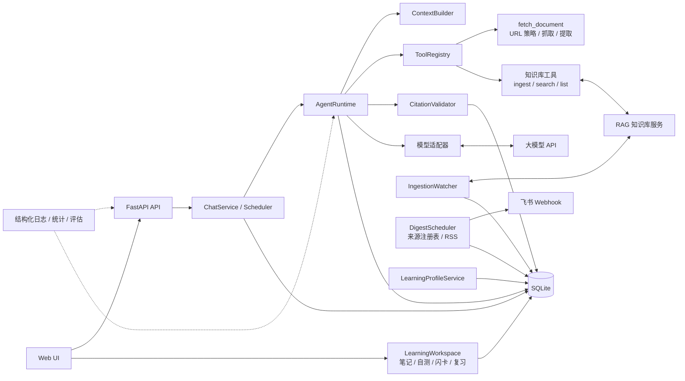

# AI Learning Agent

> 本地可运行的 AI 学习助手：阅读官方技术文档并给出可核验引用；把链接显式收藏进 RAG 知识库，
> 之后基于已入库内容检索、回答并引用来源；每天启动后把 AI 资讯 Digest 推送到飞书。

**Python 3.12 · FastAPI · SQLAlchemy / SQLite · Alembic · OpenAI 兼容 API · Docker · pytest / ruff / GitHub Actions**

单用户、本机运行、模块化单体（当前版本 v3.3.1）。知识库是可选外部依赖；
RAG 不可用时文档阅读链路仍可正常工作。

## 项目亮点

- **完整 Agent 链路**：模型 ↔ 工具循环、真实抓取/检索、上下文预算、服务端引用校验，失败如实报告。
- **长期知识库**：`ingest_urls` 异步入库、watcher 完成通知、`search_knowledge` 证据检索，
  来源标记为 `knowledge_base`。
- **每日 AI 资讯**：可信来源注册表、RSS/Atom 增量抓取、去重、筛选、Digest 生成和飞书推送；
  采用启动触发，不依赖固定钟点。
- **学习闭环**：Digest 一键生成带来源笔记，自动生成自测题和闪卡，按复习结果维护下次复习时间与薄弱主题。
- **跨对话学习画像**：记录主题、薄弱概念及其证据，支持开关、主题状态调整、概念校正和清空。
- **日常操作工作台**：网页内完成资讯偏好、来源健康与启停、Digest 反馈、RAG 收藏、自测和复习。
- **安全边界**：域名白名单、SSRF / DNS rebinding 防护、逐跳重定向校验、外部链接协议校验、
  CSP 与安全响应头、体积/超时/轮数/工具次数上限、日志脱敏。
- **可观测与可回归**：`run_id` 贯穿日志与运行记录；统计含 p50/p95、成本、知识库失败率与 watch 积压。
- **工程质量**：离线测试 + 12 个真实模型测试；CI 覆盖锁文件、格式、Lint、前端安全检查与离线测试；
  真实知识库冒烟 3/3。

## 架构



### 目录结构

```text
src/learning_agent/
├── api/            # 路由与请求/响应 Schema
├── application/    # ChatService、RunScheduler、IngestionWatcher、Digest、Profile
├── agent/          # Runtime、上下文、工具注册、引用校验、Prompt
├── models/         # OpenAI 兼容适配器
├── tools/
│   ├── document/   # URL 策略、抓取、正文提取
│   └── knowledge/  # 入库/查询/检索工具与 RAG 客户端
├── digest/         # RSS/Atom、来源默认值、飞书 Webhook
├── persistence/    # SQLite / SQLAlchemy / Repository / 迁移
├── observability/  # 结构化日志与脱敏
├── web/            # 原生聊天界面与学习工作台
└── main.py         # 应用装配
tests/  evals/  migrations/  scripts/  docs/
```

### 一次运行

- **读文档**：提交 URL → 安全校验 → 抓取/提取 → 工具结果 → 带 `[S1]` 引用的回答。
- **存知识库**：`ingest_urls` → RAG job → watcher 轮询 → `ingestion_notice` 通知（不调用 LLM）。
- **查知识库**：`search_knowledge` → 证据片段 → 服务端登记来源 → 带引用的回答。
- **每日资讯**：启动触发 → 来源注册表/RSS → 去重筛选 → Digest → 飞书推送。
- **学习闭环**：Digest → 带引用笔记 → 自测/闪卡 → 复习记录 → 学习进度。
- **学习画像**：已完成对话 → 规则提取主题/概念/薄弱信号 → 证据表 → 可校正画像。

## 核心能力

| 能力 | 要点 |
| --- | --- |
| 文档阅读 | 白名单 + SSRF/重定向校验；正文/章节提取；快照复用；截断标注 |
| 知识库 | 异步入库、`force_refresh`、任务查询、来源列表、检索证据 |
| 每日资讯 | 来源注册表、RSS/Atom、去重、筛选、Digest、飞书 Webhook、启动触发、偏好、补发和反馈 |
| 学习画像 | 跨对话主题、概念、薄弱信号、证据和置信度；支持用户校正与启停 |
| 学习闭环 | 带来源笔记、自测题、闪卡、间隔复习、到期提醒、留存率和薄弱主题统计 |
| 引用 | `S1…` 服务端分配与校验；来源分别标记 `fetch` / `knowledge_base` |
| 对话与运行 | 多对话、历史加载、同步/异步（`?mode=async`）、单对话单活动运行、级联删除 |
| 安全 | 输入/资源上限、幂等入库、注入防护、密钥与日志脱敏；RAG 不可用可降级 |
| 可观测 | JSON 日志、`run_id`、成功率/耗时/Token/成本、知识库失败率与 watch 积压 |

## V3.3.1 当前范围

V3 系列已完成：

- `v3.3.1` 安全修订：RSS/Atom 链接仅允许 HTTP(S)，历史非法条目隔离，Web UI 增加 CSP。
- 默认来源注册表、RSS/Atom 抓取、去重、筛选、Top N 和启动触发。
- 飞书自定义机器人 Webhook、投递重试、补发和投递状态记录。
- 主题/来源/条数偏好，Digest 有用/无用反馈和按需收藏到 RAG。
- 来源健康状态（最近检查、最近错误）以及来源启停。
- 跨对话学习画像、证据记录、用户校正、开关和清空。
- Digest 一键生成带来源笔记、自测题、闪卡、`next_review_at` 和学习进度。
- `/study.html` 学习工作台，覆盖日常资讯控制、笔记、自测、复习和画像管理。

当前已知边界：

- RAG 仍是一个总库，Agent 侧仅提供 `default` collection 检索边界；真正的主题/collection 过滤需要 RAG 项目后续支持。
- 笔记、自测题和闪卡当前采用基于 Digest 标题与摘要的确定性生成，后续可切换为模型生成。
- Digest 当前使用 RSS/Atom 自带摘要；模型批量摘要、发送前预览、反馈排序、条件请求、
  robots.txt 和全局紧急停止列为 V3.4。
- 邮件、Telegram 和 V4 的长期记忆/上下文工程不属于 V3。

> API 文档：启动后访问 `/docs`；健康检查 `/health/live`、`/health/ready`。

## 快速开始

**环境**：Python 3.12 + uv；OpenAI 兼容模型 API；可选 RAG 服务（默认 `127.0.0.1:8001`）与 Docker。

```powershell
uv sync
Copy-Item .env.example .env
# 必填：MODEL_API_KEY / MODEL_NAME / MODEL_BASE_URL
# 可选：KNOWLEDGE_BASE_ENABLED、KNOWLEDGE_BASE_URL、ALLOWED_DOCUMENT_HOSTS
# 每日资讯：DIGEST_ENABLED=true、FEISHU_ENABLED=true、FEISHU_WEBHOOK_URL
# 手动阅读：MANUAL_FETCH_MODE=trusted_only（默认）或 open_public
```

```powershell
uv run uvicorn --factory learning_agent.main:create_app --host 127.0.0.1 --port 8000
```

打开 <http://127.0.0.1:8000/> 使用对话，打开
<http://127.0.0.1:8000/study.html> 使用学习工作台；`/health/ready` 返回数据库、模型与
`knowledge_base` 状态。
知识库不可用时 Agent 仍可启动，文档阅读不受影响。

**验证**

```powershell
uv run pytest -m "not real_model"                 # 离线测试
uv run pytest -m real_model                       # 真实模型（产生费用）
uv run ruff format --check . && uv run ruff check .
uv run python -m scripts.smoke_knowledge --base-url http://127.0.0.1:8000   # 需 RAG 可用
```

**Docker**

```powershell
docker compose build
docker compose up -d
curl http://127.0.0.1:8000/health/ready
```

容器默认通过 `host.docker.internal:8001` 访问宿主机 RAG；数据在 `./data`，密钥由 `.env` 注入。

每日资讯默认 `DIGEST_ENABLED=false`。启用后，Agent 启动完成会检查当天 Digest；
如果未完成，会抓取来源、生成 Digest 并推送飞书。任务完成后可执行
`docker compose down` 停止本项目容器释放内存。

Windows 计划任务可设置为“用户登录时”运行：

```powershell
powershell -ExecutionPolicy Bypass -File .\scripts\run_daily_digest.ps1
```

脚本会启动 Compose、等待 `/health/ready`、轮询当天 Digest，任务终态后执行
`docker compose down`；失败时保留 `data/daily-digest-error.log` 供排查。

**备份**：`uv run python -m scripts.backup_database --output backups/app.db`；
RAG 数据按其项目文档单独备份。

V3.3.1 发布前的自动化与手工检查见
[`docs/release-checklist-v3.3.md`](docs/release-checklist-v3.3.md)。

## 许可

MIT License，见 [LICENSE](LICENSE)。
