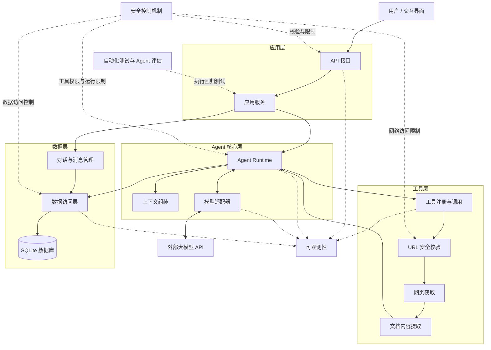

# AI Learning Agent

> 本地可运行的 AI 学习助手：提交官方技术文档 URL，Agent 调用文档工具获取并解析内容，
> 再基于真实抓取结果讲解核心概念，并给出可核验的来源引用。

**技术栈**：Python 3.12 · FastAPI · SQLAlchemy 2 / SQLite · Alembic · OpenAI 兼容模型 API ·
Docker Compose · pytest / ruff / GitHub Actions

项目边界聚焦「读官方文档并讲清楚」这一件事；工程上则把 Agent 应用的关键难点——工具调用循环、
上下文预算、引用校验、安全边界、失败恢复、可观测性与评估——做成可运行、可测试、可回归的闭环。

## 项目概览

| 维度 | 内容 |
| --- | --- |
| 目标用户 | 需要按官方文档系统学习新技术、并希望答案可追溯的个人开发者 |
| 核心流程 | 提交文档 URL → 抓取与正文提取 → 模型请求工具 → 工具执行 → 基于内容回答并标注来源 |
| 运行形态 | 单用户、单进程、模块化单体；默认仅监听 `127.0.0.1` |
| 数据存储 | SQLite（对话、消息、运行、工具调用、文档快照、来源关联） |
| 当前版本 | v1.0.0（已完成 v1.1 工程优化：异步运行、异步数据访问、成本估算、快照去重等） |
| 质量证据 | 186 个自动化测试（174 离线 + 12 真实模型）；12 个固定评估案例；CI 覆盖格式、Lint 与离线测试 |

## 架构

### 架构图



### 分层职责

| 层 | 目录 | 职责 | 不承担 |
| --- | --- | --- | --- |
| API | `src/learning_agent/api/` | 路由、请求/响应 Schema、HTTP 错误映射 | 模型循环、SQL |
| 应用 | `application/` | 提交消息、协调对话与运行、后台调度 | HTML 解析、模型协议 |
| Agent | `agent/` | Runtime、上下文预算、Prompt、工具注册、引用校验 | 抓网页、写 SQL |
| 模型 | `models/` | OpenAI 兼容适配器、工具调用与用量解析 | 对话业务 |
| 工具 | `tools/document/` | URL 策略、HTTP 获取、正文提取与规范化 | 生成回答、写业务表 |
| 持久化 | `persistence/` | 引擎、ORM、Repository、迁移入口 | 业务编排 |
| 观测 | `observability/` | 结构化日志、关联 ID、脱敏 | 判定业务成败 |

### 目录结构

```text
.
├── src/learning_agent/
│   ├── api/                 # FastAPI 路由与 Schema
│   ├── application/         # 应用服务与运行调度
│   ├── agent/               # Agent Runtime、上下文、工具注册、引用校验
│   ├── models/              # 模型适配器
│   ├── tools/document/      # fetch_document：URL 策略、抓取、提取、规范化
│   ├── persistence/         # SQLite / SQLAlchemy / Repository / 迁移
│   ├── observability/       # 结构化日志与脱敏
│   ├── web/                 # 最小聊天界面（原生 HTML/CSS/JS）
│   ├── config.py            # 集中配置与校验
│   └── main.py              # 应用装配
├── tests/
│   ├── unit/                # 纯逻辑与边界
│   ├── integration/         # 服务、数据库、安全与故障场景
│   ├── e2e/                 # API 全链路（脚本化模型）
│   └── support/             # 本地文档服务器、脚本化模型等夹具
├── evals/                   # 12 个固定评估案例、判定规则与回归比较
├── migrations/              # Alembic 迁移
├── scripts/                 # 升级、备份、恢复
├── docs/                    # 架构、威胁模型、ADR、验收记录
├── Dockerfile
├── docker-compose.yml
└── pyproject.toml / uv.lock
```

### 一次运行的数据流

1. `POST /api/v1/conversations/{id}/messages` 进入 `ChatService`，完成输入校验与长度限制。
2. `AgentRuntime` 创建运行记录并保存用户消息；数据库约束保证同一对话同时只有一个活动运行。
3. `ContextBuilder` 组装系统提示、最近历史与本次可用文档，按 Token 预算裁剪并标注截断。
4. 模型请求 `fetch_document` → `ToolRegistry` 校验工具与参数 → `UrlPolicy`（协议/白名单/端口/DNS 公网校验）
   → `DocumentFetcher`（逐跳重定向校验、超时与体积限制）→ 正文提取与规范化。
5. 工具结果写入文档快照与来源关联；`run_id` 贯穿日志、运行记录与统计数据。
6. 模型生成回答后，`CitationValidator` 校验引用编号与链接；无效引用被移除并记录，最终消息与运行状态落库。

失败路径：任一阶段失败都会写入 `error_code` / `error_category`，运行状态置为 `failed`，
API 返回安全的错误结构与 `run_id`，不会把失败包装成成功回答。

## v1.0 功能

### Agent Runtime

- 模型 ↔ 工具循环；最大模型轮数、工具调用次数、单次运行时限三重上限。
- 上下文 Token 预算（含安全系数）与截断标注；超限映射为可操作的错误提示。
- `run_id` 关联模型调用、工具调用、日志与统计数据。

### 文档工具 `fetch_document`

- 精确域名白名单（留空即拒绝）、仅 `http/https`、拒绝 URL 凭据、端口限制。
- DNS 解析与对端地址双重校验，拒绝回环/内网/链路本地/保留地址；重定向逐跳重新校验。
- 连接/读取超时、响应体与正文字符上限；`trafilatura` + `lxml` 提取正文与章节。
- 内容哈希与截断标记；后续追问优先复用已保存快照，避免重复抓取。

### 来源与引用

- 来源编号（`S1`…）由服务端分配；链接与标题来自服务端登记的真实来源，模型无法伪造。
- 引用由服务端校验；无效引用会被移除并记录。
- 文档被截断或获取失败时，回答必须显式说明限制，不得声称完整阅读。

### 对话、运行与数据

- 多对话创建/列表/切换/删除；运行中删除返回 409；删除时级联清理关联数据。
- SQLite + SQLAlchemy 2.0 + Alembic；启动自动迁移，旧库自动 stamp。
- 对话、消息、运行、工具调用、文档快照与来源关联均可追溯。

### 异步执行与调度

- 默认同步返回；`?mode=async` 立即返回 202 与 `run_id`，后台执行并可轮询
  `GET /api/v1/runs/{run_id}`。
- 后台任务由调度器持有并支持优雅关闭；同一对话的活动运行由数据库部分唯一索引保证唯一，
  启动时回收遗留的未完成运行（标记为失败）。

### 界面与 API

- `/` 提供对话列表、消息区、输入框、运行状态与来源链接；轻量 Markdown 渲染，
  仅生成 DOM 节点，不使用 `innerHTML`。
- API：`/health/live`、`/health/ready`、`/api/v1/conversations`、消息接口、
  `/api/v1/runs/{run_id}`、`/api/v1/stats`。

### 可观测性

- 结构化 JSON 日志，包含 `run_id` / `conversation_id` / 阶段 / 耗时 / 错误码，并对密钥与敏感字段脱敏。
- `GET /api/v1/stats` 汇总成功率、耗时均值与 p50/p95、Token 用量、估算成本、
  工具失败率与文档获取成功率。

## 工程质量与验证

| 检查 | 内容 | 结果 |
| --- | --- | --- |
| 单元 / 集成 / E2E | 174 个离线测试：URL 策略、工具注册、上下文预算、引用校验、并发、重启恢复、迁移、备份恢复、注入防护等 | 2026-10-18：174 passed |
| 真实模型测试 | 12 个真实 API + 真实文档链路测试 | 2026-10-13：12 passed（产生外部请求与费用） |
| 静态检查 | `ruff format --check` + `ruff check` | 通过 |
| CI | GitHub Actions：格式、Lint、离线测试 | `.github/workflows/ci.yml` |
| Agent 评估 | 12 个固定案例，规则化判定 + 基线回归 | 12/12（2026-10-13 基线） |
| 容器验证 | 构建、启动、容器内真实问答、重启持久化、备份恢复 | 已通过（见[验收记录](docs/verification-log.md)） |

设计取舍与限制：

- 选用 SQLite 与单进程：目标是最小运维成本的本机应用；多用户与跨进程扩展不在 v1.0 范围。
- 只抓取白名单域名：默认安全优先，未配置白名单时拒绝所有外部抓取。
- 评估以规则检查为主（来源、状态、引用、限制），不依赖模型自评；主观质量仍需人工抽查。
- 当前未实现流式输出、文件上传、跨对话长期记忆与远程认证；暴露到公网前必须补认证与 HTTPS。

## 迭代规划（v2–v5）

v1.0 已完成核心 Agent 链路，并提前落地了对话管理、安全加固、可观测性、评估与容器化部署。
后续版本在此基础上继续演进：

### v2 对话管理与数据可靠性

- 现状：多轮对话、会话隔离、Alembic 迁移、备份与恢复已具备。
- 计划：对话检索、归档与导出；更细的删除与保留策略；可切换的 PostgreSQL 存储；
  备份自动化与恢复演练回归。

### v3 安全与故障恢复

- 现状：URL/SSRF 防护、注入测试、资源上限、错误分类与有限重试已具备。
- 计划：远程访问的认证与 HTTPS；工具级权限与沙箱；速率限制与配额；
  依赖漏洞扫描与安全审计。

### v4 可观测性与评估

- 现状：运行 trace、统计接口、12 个固定评估案例与回归比较已具备。
- 计划：OpenTelemetry/指标导出与告警；更大规模评估集与自动评审；
  按版本存档的效果对比与成本看板。

### v5 部署与正式交付

- 现状：Dockerfile/Compose、健康检查、CI、备份恢复脚本已具备。
- 计划：镜像发布与版本管理；多环境配置（dev/prod）；灰度与回滚；SLO 与故障演练。

## 部署与运行

### 环境要求

- Python 3.12（由 `uv` 管理）与 [uv](https://docs.astral.sh/uv/)
- 可用的 OpenAI 兼容模型 API（默认 DeepSeek）
- Docker Desktop（可选，用于容器化部署）

### 本地安装与启动

```powershell
uv sync
Copy-Item .env.example .env
# 编辑 .env：至少填写 MODEL_API_KEY，并按需配置 ALLOWED_DOCUMENT_HOSTS
uv run uvicorn --factory learning_agent.main:create_app --host 127.0.0.1 --port 8000
```

启动时自动执行数据库迁移。打开 <http://127.0.0.1:8000/> 使用界面；健康检查：

```powershell
curl http://127.0.0.1:8000/health/live
curl http://127.0.0.1:8000/health/ready
```

`ALLOWED_DOCUMENT_HOSTS` 为空表示拒绝一切外部抓取；全部配置项与默认值见
[.env.example](.env.example)。

### 测试与静态检查

```powershell
uv run pytest -m "not real_model"   # 离线测试，不产生外部调用
uv run pytest -m real_model         # 真实模型测试（需要密钥，产生费用）
uv run ruff format --check .
uv run ruff check .
```

### Docker Compose

```powershell
docker compose build
docker compose up -d
curl http://127.0.0.1:8000/health/ready
docker compose down
```

- 端口仅绑定 `127.0.0.1`，数据落在 `./data` 卷；密钥从 `.env` 注入，不写入镜像。
- 国内网络可指定镜像站：
  `docker compose build --build-arg PYTHON_IMAGE=docker.m.daocloud.io/library/python:3.12-slim`。

### 数据迁移、备份与恢复

```powershell
uv run python -m scripts.upgrade_database
uv run python -m scripts.backup_database --output backups/app.db
uv run python -m scripts.restore_database --backup backups/app.db --target data/restored.db
```

恢复后把 `DATABASE_URL` 指向恢复文件并重启应用。备份脚本会做完整性校验并输出各表行数。

### 常见问题

- 启动时报配置缺失：`MODEL_API_KEY` / `MODEL_NAME` / `MODEL_BASE_URL` 任一为空都会拒绝启动。
- 文档抓取被拒绝：检查 `ALLOWED_DOCUMENT_HOSTS` 是否包含目标主机（精确匹配，不支持通配符）。
- 远程访问：默认只监听回环地址；需要远程访问时请置于认证的 HTTPS 反向代理或 VPN 之后。

## 文档索引

- [架构说明](docs/architecture.md) · [威胁模型与残余风险](docs/threat-model.md) ·
  [验收与演练记录](docs/verification-log.md)
- 设计决策：[ADR 0001 模型接口](docs/adr/0001-model-provider.md) ·
  [ADR 0002 正文提取](docs/adr/0002-html-extraction.md) ·
  [ADR 0003 持久化与迁移](docs/adr/0003-persistence-and-migrations.md) ·
  [ADR 0004 评估策略](docs/adr/0004-agent-evaluation.md) ·
  [ADR 0005 异步运行](docs/adr/0005-async-run-execution.md)
- [Agent 评估标准](evals/criteria.md) · [评估案例](evals/cases/core.json) ·
  [基线结果](evals/results/baseline-20261013.json)

## 许可

MIT License，见 [LICENSE](LICENSE)。
