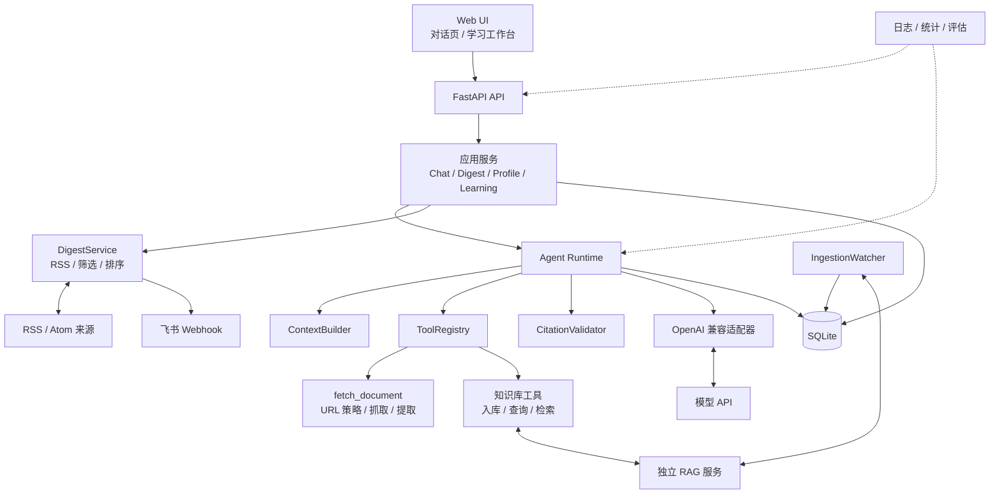

# AI Learning Agent — 本地可追溯的 AI 学习助手

> 面向个人学习场景的本地 AI Agent。它既能阅读技术文档并给出可核验引用，也能把资料收藏进 RAG 知识库，每天整理 AI 资讯推送到飞书，再把资讯转化为笔记、自测题、闪卡和复习计划。

当前版本：**v3.3.2**

项目形态：**单用户、本机优先、模块化单体**

---

## 项目简介

本项目是一个完整运行在本机的个人 AI 学习助手。系统以 FastAPI 单体进程提供 Web UI、API、Agent Runtime 和后台任务；SQLite 保存本地业务数据，RAG、模型 API 和飞书作为可选或外部服务接入。

项目已覆盖以下能力：

- **技术文档问答**：读取用户指定的公开技术文档，提取正文与章节，基于上下文预算生成回答。
- **可核验引用**：引用编号由服务端分配和校验，模型无法伪造不存在的来源。
- **连续对话与异步运行**：支持多对话、历史加载、同步等待和异步提交后轮询。
- **RAG 长期知识库**：用户明确收藏后异步入库，后台轮询任务状态，完成后写入确定性通知。
- **知识库检索**：基于已入库证据回答问题，并区分网页来源与知识库来源。
- **每日 AI 资讯**：从可信 RSS/Atom 来源抓取资讯，完成去重、筛选、排序和 Digest 生成。
- **飞书日报推送**：支持自定义机器人 Webhook、签名校验、有限重试、投递状态和日期幂等。
- **资讯个性化**：可配置主题、来源、每日条数和补发天数，并管理来源健康与启停。
- **Digest 反馈**：支持“有用 / 无用 / 收藏到知识库”。
- **学习画像**：从已完成对话中记录主题、概念、薄弱信号、证据和置信度，支持用户校正、删除和关闭。
- **学习闭环**：将 Digest 转为带来源笔记，生成自测题和闪卡，记录复习结果并计算下次复习时间。
- **学习工作台**：在 `/study.html` 管理资讯、来源、画像、笔记、自测、闪卡和复习。
- **安全边界**：URL 白名单、SSRF / DNS rebinding 防护、逐跳重定向校验、提示注入隔离、资源上限和日志脱敏。
- **可观测与可恢复**：运行记录贯穿 `run_id`，统计成功率、耗时、Token、成本和知识库状态；支持 Alembic、SQLite 备份恢复和启动恢复。

---

## 技术栈

| 层级 | 技术 | 用途 |
|---|---|---|
| Web / API | FastAPI + Uvicorn | REST API、静态页面和生命周期管理 |
| Agent | 自研轻量 Agent Runtime | 模型与工具循环、上下文预算、引用校验 |
| 模型 | OpenAI 兼容 API | 对话、工具选择、结构化输出 |
| 知识库 | 独立 RAG HTTP 服务 | 网页入库、混合检索、证据来源 |
| 数据 | SQLite + SQLAlchemy + Alembic | 对话、Digest、画像、笔记和复习数据 |
| 资讯 | RSS / Atom + 飞书 Webhook | 来源抓取、Digest 生成和消息推送 |
| 前端 | HTML + CSS + 原生 JavaScript | 对话页和学习工作台 |
| 部署 | Docker Compose / 本机 Python | 单实例、本机回环访问 |
| 质量 | pytest + Ruff + Node Test + GitHub Actions | 离线测试、格式、Lint 和前端安全检查 |

---

## 系统架构



核心边界：

- Web UI、API、Agent 和后台任务运行在同一个 FastAPI 进程中。
- SQLite 是 Agent 侧权威数据源。
- RAG 是独立外部服务，Agent 只通过 HTTP 访问。
- RAG 不可用时，文档阅读、普通对话和 Digest 仍可运行。
- 系统只支持单实例、单 Worker。

---

## 核心功能

### 1. Agent 文档问答

一次文档问答由以下步骤组成：

```text
用户提交问题
→ 创建 Run
→ 加载历史与可复用文档
→ ContextBuilder 按 Token 预算组装上下文
→ 模型调用 fetch_document
→ URL 策略校验、抓取、正文提取
→ 模型生成回答
→ CitationValidator 校验引用和外部链接
→ 保存回答、来源、工具调用和运行状态
```

文档内容始终按不可信数据进入上下文，不能覆盖系统规则，也不能直接扩大工具权限。

### 2. 对话与运行

- 对话可创建、切换、查看和删除。
- 同步模式等待模型与工具循环结束。
- `?mode=async` 立即返回 `run_id`，前端轮询运行状态。
- 同一对话由数据库部分唯一索引保证只有一个活动 Run。
- 进程中断后，遗留的 pending/running Run 会在下次启动时标记为失败。

### 3. RAG 知识库

知识库链路包含四个工具：

| 工具 | 用途 |
|---|---|
| `ingest_urls` | 将用户明确要求收藏的链接提交入库 |
| `get_ingestion` | 查询异步任务状态与失败项 |
| `list_sources` | 查看最近已收录来源 |
| `search_knowledge` | 检索证据片段并生成可引用来源 |

`ingest_urls` 和强制刷新都必须匹配当前用户消息中的明确意图；普通文档内容和模型猜测不能自行触发长期写入。

### 4. 每日 AI 资讯与飞书

Digest 流水线：

```text
读取启用来源与用户偏好
→ 抓取 RSS / Atom
→ canonical URL 去重
→ 主题、来源和时效筛选
→ Top N 排序
→ 生成 Digest
→ 飞书 Webhook 投递
→ 保存投递状态
```

支持：

- 启动检查和手动触发；
- 补发最近未完成的 Digest；
- 按日期幂等；
- 来源健康状态与启停；
- 有用 / 无用反馈；
- 将单条资讯收藏到 RAG。

### 5. 学习画像

- 从成功完成的普通对话中提取主题、概念和薄弱信号。
- 每条事件保留对应 Run、证据文本和置信度。
- 用户校正后的画像不会被后续自动规则覆盖。
- 支持关闭、主题状态调整、概念校正、主题删除和全部清空。
- 画像只保存和展示，不自动注入 Prompt，不作为知识库证据。

### 6. 学习闭环

```text
Digest 条目
→ 带来源学习笔记
→ 确定性自测题
→ 闪卡
→ 到期复习队列
→ 用户提交评分
→ 更新复习间隔和下次时间
→ 聚合学习进度与薄弱主题
```

笔记、自测题和闪卡目前使用确定性规则生成，不额外调用模型。

### 7. 学习工作台

访问：

```text
http://127.0.0.1:8000/study.html
```

工作台提供：

- 今日 Digest 与反馈；
- 资讯偏好和来源健康；
- RAG 收藏状态；
- 笔记、自测题和闪卡；
- 到期复习；
- 学习进度；
- 画像查看、校正和清空。

### 8. 安全与异常处理

- 手动抓取和 Digest 抓取都执行 URL 策略。
- 拒绝非 HTTP(S)、URL 凭据、私网、回环、云元数据和异常端口。
- DNS 解析结果必须全部为公网地址。
- 每次重定向重新校验，并检查实际连接对端。
- 限制请求超时、响应大小、重定向、正文长度、模型轮数和工具次数。
- 工具参数中的 URL 查询参数和敏感字段会递归脱敏。
- 最终结果落库失败时，Run 会转为失败，不长期占用活动状态。
- API 错误不暴露堆栈、SQL、环境变量或内部 URL。

---

## 项目结构

```text
ai_learning_agent/
├── src/learning_agent/
│   ├── api/               # FastAPI 路由与响应模型
│   ├── application/       # Chat、Digest、画像、学习闭环服务
│   ├── agent/             # Runtime、上下文、Prompt、工具与引用校验
│   ├── models/            # OpenAI 兼容模型适配器
│   ├── tools/
│   │   ├── document/      # URL 策略、抓取、提取、规范化
│   │   └── knowledge/     # RAG 工具与 HTTP 客户端
│   ├── digest/            # RSS/Atom 与飞书适配器
│   ├── persistence/       # SQLite、Repository、迁移入口
│   ├── observability/     # 结构化日志与脱敏
│   ├── web/               # 对话页与学习工作台
│   └── main.py            # 应用装配与生命周期
├── migrations/            # Alembic 迁移
├── tests/                 # 单元、集成和端到端测试
├── evals/                 # Agent 评估与回归
├── scripts/               # 备份、恢复、知识库冒烟和每日任务
├── docs/                  # 架构、ADR、威胁模型与验收记录
├── docker-compose.yml
├── Dockerfile
└── pyproject.toml
```

---

## 快速启动

### 环境要求

- Python 3.12
- uv
- OpenAI 兼容模型 API
- 可选：独立 RAG 服务
- 可选：飞书自定义机器人 Webhook
- 可选：Docker Desktop

### 1. 安装依赖

```powershell
uv sync
Copy-Item .env.example .env
```

### 2. 配置环境变量

至少配置：

```dotenv
MODEL_API_KEY=...
MODEL_NAME=...
MODEL_BASE_URL=https://api.deepseek.com/v1
```

常用配置：

| 配置 | 作用 |
|---|---|
| `ALLOWED_DOCUMENT_HOSTS` | 手动抓取允许的精确域名 |
| `MANUAL_FETCH_MODE` | `trusted_only` 或 `open_public` |
| `KNOWLEDGE_BASE_ENABLED` | 是否启用 RAG 工具 |
| `KNOWLEDGE_BASE_URL` | RAG 服务地址 |
| `DIGEST_ENABLED` | 是否启用每日资讯服务 |
| `DIGEST_TRIGGER` | `manual` 或 `on_startup` |
| `FEISHU_ENABLED` | 是否启用飞书推送 |
| `FEISHU_WEBHOOK_URL` | 飞书机器人 Webhook |
| `FEISHU_WEBHOOK_SECRET` | 飞书签名 Secret |

`.env` 已被 Git 忽略，不要提交任何密钥。

### 3. 启动 RAG（可选）

本项目不包含 RAG 服务源码。RAG 可作为独立进程运行，默认地址：

```text
http://127.0.0.1:8001
```

关闭知识库功能不影响文档阅读和 Digest：

```dotenv
KNOWLEDGE_BASE_ENABLED=false
```

### 4. 本机启动 Agent

```powershell
uv run uvicorn --factory learning_agent.main:create_app --host 127.0.0.1 --port 8000
```

访问：

- 对话页：<http://127.0.0.1:8000/>
- 学习工作台：<http://127.0.0.1:8000/study.html>
- API 文档：<http://127.0.0.1:8000/docs>
- 健康检查：`/health/live`、`/health/ready`

### 5. Docker 启动

```powershell
docker compose build
docker compose up -d
curl.exe http://127.0.0.1:8000/health/ready
```

Compose 只启动 Agent，不启动 RAG。容器内默认通过：

```text
http://host.docker.internal:8001
```

访问宿主机 RAG。SQLite 数据挂载在 `./data`，密钥通过 `.env` 注入，不写入镜像。

停止容器：

```powershell
docker compose down
```

### 6. 每日任务脚本

```powershell
powershell -ExecutionPolicy Bypass -File .\scripts\run_daily_digest.ps1
```

脚本会：

```text
启动 Compose
→ 等待 Agent ready
→ 显式触发当天 Digest
→ 等待 completed / failed
→ 关闭 Compose
```

它兼容 `DIGEST_TRIGGER=manual`，并依赖 Docker Desktop 已经启动。

---

## API 入口

| 方法 | 路径 | 说明 |
|---|---|---|
| `POST` | `/api/v1/conversations` | 创建对话 |
| `GET` | `/api/v1/conversations` | 对话列表 |
| `GET` | `/api/v1/conversations/{id}/messages` | 历史消息与来源 |
| `DELETE` | `/api/v1/conversations/{id}` | 删除对话及关联数据 |
| `POST` | `/api/v1/conversations/{id}/messages` | 同步或异步运行 Agent |
| `GET` | `/api/v1/runs/{run_id}` | 运行状态、工具调用与来源 |
| `GET` | `/api/v1/stats` | 运行、Token、成本和知识库统计 |
| `POST` | `/api/v1/digests/run` | 手动触发 Digest |
| `GET` | `/api/v1/digests/today` | 今日 Digest |
| `GET` | `/api/v1/push/sources` | 资讯来源与健康状态 |
| `GET` | `/api/v1/push/preferences` | 资讯偏好 |
| `GET` | `/api/v1/learning-profile` | 学习画像 |
| `GET` | `/api/v1/learning/progress` | 学习进度 |

完整参数与响应模型可在启动后访问 `/docs`。

---

## 验证与质量

```powershell
uv run pytest -m "not real_model"
uv run pytest -m real_model
uv run ruff check .
uv run ruff format --check .
uv lock --check

node --check src/learning_agent/web/safe-url.js
node --check src/learning_agent/web/app.js
node --check src/learning_agent/web/study.js
node --test tests/frontend/test_safe_url.js
```

当前验收结果：

- 266 个离线测试通过，12 个真实模型测试按需执行。
- Ruff、前端语法、安全 URL 单测和锁文件检查通过。
- 真实模型文档问答通过。
- 真实 RAG 入库、通知、检索与引用通过。
- 真实 RSS 和飞书 Digest 投递通过。
- 原生与 Docker 重启持久化通过。
- SQLite 备份恢复通过。
- Docker Compose、单进程运行和每日任务脚本通过。

详细记录见：

- [架构设计](docs/architecture.md)
- [威胁模型](docs/threat-model.md)
- [验收与演练记录](docs/verification-log.md)
- [v3.3.2 发布检查清单](docs/release-checklist-v3.3.2.md)
- [v3.3.2 收口计划](docs/v3-closure-plan.md)

---

## 已知边界

- 系统面向单用户本机运行，没有登录和多用户隔离。
- 应用与 RAG 没有应用级认证，禁止直接暴露到公网。
- 后台调度和 SQLite 仅支持单实例、单 Worker。
- RAG 当前只有 `default` 总库，没有主题级 collection 隔离。
- Digest 使用 RSS/Atom 自带摘要，不调用模型批量生成摘要。
- 笔记、自测题和闪卡使用确定性规则生成。
- 学习画像不自动注入模型上下文。
- 推送渠道只支持飞书。

---

## 文档

- [架构设计](docs/architecture.md)
- [V3 项目说明书](项目说明_v3.0.md)
- [威胁模型](docs/threat-model.md)
- [构建与验收记录](docs/verification-log.md)
- [发布检查清单](docs/release-checklist-v3.3.2.md)
- [ADR 决策记录](docs/adr/)

---

## 许可

MIT License，见 [LICENSE](LICENSE)。
