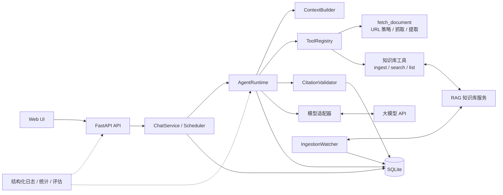

# AI Learning Agent

> 本地可运行的 AI 学习助手：阅读官方技术文档并给出可核验引用；把链接显式收藏进 RAG 知识库，
> 之后基于已入库内容检索、回答并引用来源。

**Python 3.12 · FastAPI · SQLAlchemy / SQLite · Alembic · OpenAI 兼容 API · Docker · pytest / ruff / GitHub Actions**

单用户、本机运行、模块化单体（当前版本 v2.0.0）。知识库是可选外部依赖；
RAG 不可用时文档阅读链路仍可正常工作。

## 项目亮点

- **完整 Agent 链路**：模型 ↔ 工具循环、真实抓取/检索、上下文预算、服务端引用校验，失败如实报告。
- **长期知识库**：`ingest_urls` 异步入库、watcher 完成通知、`search_knowledge` 证据检索，
  来源标记为 `knowledge_base`。
- **安全边界**：域名白名单、SSRF / DNS rebinding 防护、逐跳重定向校验、体积/超时/轮数/工具次数上限、
  日志脱敏。
- **可观测与可回归**：`run_id` 贯穿日志与运行记录；统计含 p50/p95、成本、知识库失败率与 watch 积压。
- **工程质量**：220 个离线测试 + 12 个真实模型测试；CI 覆盖格式、Lint 与离线测试；
  真实知识库冒烟 3/3。

## 架构



### 目录结构

```text
src/learning_agent/
├── api/            # 路由与请求/响应 Schema
├── application/    # ChatService、RunScheduler、IngestionWatcher
├── agent/          # Runtime、上下文、工具注册、引用校验、Prompt
├── models/         # OpenAI 兼容适配器
├── tools/
│   ├── document/   # URL 策略、抓取、正文提取
│   └── knowledge/  # 入库/查询/检索工具与 RAG 客户端
├── persistence/    # SQLite / SQLAlchemy / Repository / 迁移
├── observability/  # 结构化日志与脱敏
├── web/            # 原生聊天界面
└── main.py         # 应用装配
tests/  evals/  migrations/  scripts/  docs/
```

### 一次运行

- **读文档**：提交 URL → 安全校验 → 抓取/提取 → 工具结果 → 带 `[S1]` 引用的回答。
- **存知识库**：`ingest_urls` → RAG job → watcher 轮询 → `ingestion_notice` 通知（不调用 LLM）。
- **查知识库**：`search_knowledge` → 证据片段 → 服务端登记来源 → 带引用的回答。

## 核心能力

| 能力 | 要点 |
| --- | --- |
| 文档阅读 | 白名单 + SSRF/重定向校验；正文/章节提取；快照复用；截断标注 |
| 知识库 | 异步入库、`force_refresh`、任务查询、来源列表、检索证据 |
| 引用 | `S1…` 服务端分配与校验；来源分别标记 `fetch` / `knowledge_base` |
| 对话与运行 | 多对话、历史加载、同步/异步（`?mode=async`）、单对话单活动运行、级联删除 |
| 安全 | 输入/资源上限、幂等入库、注入防护、密钥与日志脱敏；RAG 不可用可降级 |
| 可观测 | JSON 日志、`run_id`、成功率/耗时/Token/成本、知识库失败率与 watch 积压 |

> API 文档：启动后访问 `/docs`；健康检查 `/health/live`、`/health/ready`。

## 工程质量

| 检查 | 结果 |
| --- | --- |
| 离线测试 | 220 passed（URL 策略、上下文、引用、并发、迁移、备份、注入、知识库全链路） |
| 真实模型 | 12 passed（真实文档链路，2026-10-13） |
| 知识库冒烟 | 3/3 通过（本地 5 篇语料，来源均为 `knowledge_base`；[结果](evals/results/knowledge-smoke-20261020.json)） |
| 评估 | 12 个固定案例，支持基线回归 |
| CI | ruff format / ruff check / 离线 pytest |

限制：单用户本机、默认仅监听 `127.0.0.1`；未实现流式输出、文件上传、远程认证；
跨主机部署需为 RAG 补鉴权。评估以规则检查为主，主观质量仍需人工抽查。

## 快速开始

**环境**：Python 3.12 + uv；OpenAI 兼容模型 API；可选 RAG 服务（默认 `127.0.0.1:8001`）与 Docker。

```powershell
uv sync
Copy-Item .env.example .env
# 必填：MODEL_API_KEY / MODEL_NAME / MODEL_BASE_URL
# 可选：KNOWLEDGE_BASE_ENABLED、KNOWLEDGE_BASE_URL、ALLOWED_DOCUMENT_HOSTS
```

```powershell
uv run uvicorn --factory learning_agent.main:create_app --host 127.0.0.1 --port 8000
```

打开 <http://127.0.0.1:8000/>；`/health/ready` 返回数据库、模型与 `knowledge_base` 状态。
知识库不可用时 Agent 仍可启动，文档阅读不受影响。

**验证**

```powershell
uv run pytest -m "not real_model"                 # 离线测试
uv run pytest -m real_model                       # 真实模型（产生费用）
uv run ruff format --check . && uv run ruff check .
uv run python -m scripts.smoke_knowledge --base-url http://127.0.0.1:8000   # 需 RAG 可用
```

**Docker**

```powershell
docker compose build
docker compose up -d
curl http://127.0.0.1:8000/health/ready
```

容器默认通过 `host.docker.internal:8001` 访问宿主机 RAG；数据在 `./data`，密钥由 `.env` 注入。

**备份**：`uv run python -m scripts.backup_database --output backups/app.db`；
RAG 数据按其项目文档单独备份。

## 迭代规划

| 版本 | 主题 | 主要工作 |
| --- | --- | --- |
| v2.1 | 对话资产管理 | 重命名/搜索/归档/导出；运行取消、全局并发与费用预算 |
| v3 | 安全与故障恢复 | 远程认证与 HTTPS、工具沙箱、速率限制、依赖审计 |
| v4 | 可观测性与评估 | 指标导出/告警、更大评估集、版本对比与成本看板 |
| v5 | 部署与交付 | 镜像发布、多环境、灰度回滚、SLO |

## 文档

- [架构说明](docs/architecture.md) · [威胁模型](docs/threat-model.md) ·
  [验收记录](docs/verification-log.md)
- 设计决策：[ADR 0001–0006](docs/adr/) · [评估标准](evals/criteria.md)

## 许可

MIT License，见 [LICENSE](LICENSE)。
