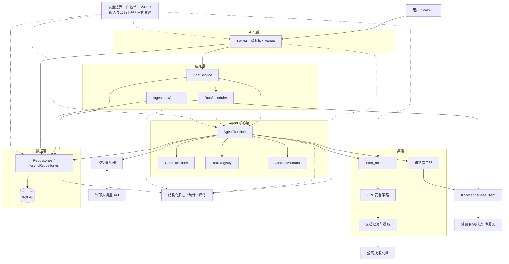

# AI Learning Agent

> 本地可运行的 AI 学习助手：既能把官方技术文档读成带来源的讲解，也能把链接显式收藏进长期知识库，
> 并在之后的提问中检索、引用已入库内容。

**技术栈**：Python 3.12 · FastAPI · Pydantic v2 · SQLAlchemy 2 / SQLite · Alembic ·
OpenAI 兼容模型 API · httpx · trafilatura / lxml · Docker Compose · pytest / ruff / GitHub Actions

## 项目简介

AI Learning Agent 面向需要按官方文档系统学习新技术、并希望答案可追溯的个人开发者。
它解决两个问题：

1. **读文档**：提交官方文档 URL，Agent 抓取并提取正文，基于真实内容讲解核心概念，并给出来源引用。
2. **长期积累**：把有价值的链接显式入库到独立 RAG 知识库，之后基于已入库内容检索、回答并引用来源。

项目定位为单用户、本机运行、模块化单体，默认仅监听 `127.0.0.1`。
知识库是**可选外部依赖**，通过 HTTP 接入独立 RAG 服务；RAG 不可用时，文档阅读链路仍可正常工作。

| 维度 | 内容 |
| --- | --- |
| 目标用户 | 需要按官方文档系统学习、并希望答案可追溯的个人开发者 |
| 核心流程 | 文档阅读：提交 URL → 抓取/提取 → 模型调用工具 → 带来源回答；知识库：显式入库 → 异步通知 → 检索证据 → 带引用回答 |
| 运行形态 | 单用户、单进程、模块化单体；默认仅监听 `127.0.0.1` |
| 数据存储 | SQLite（对话、消息、运行、工具调用、文档快照、来源关联、入库通知订阅） |
| 外部依赖 | OpenAI 兼容模型 API；可选 RAG 知识库服务 |
| 当前版本 | 2.0.0（文档阅读 + 知识库接入） |
| 质量证据 | 220 个离线测试 + 12 个真实模型测试；12 个固定评估案例；知识库真实冒烟 3/3；CI 覆盖格式、Lint 与离线测试 |

## 实现的功能

### 1. 文档阅读与讲解

- `fetch_document` 获取并解析一份已允许的 HTML 文档，返回标题、规范化 URL、获取时间、内容哈希、
  清洗后的正文与章节信息。
- URL 安全策略：精确域名白名单（留空即拒绝）、仅 `http/https`、拒绝 URL 凭据、端口限制；
  DNS 解析与连接对端地址双重校验，拒绝回环/内网/链路本地/保留地址；重定向逐跳重新校验。
- 连接/读取超时、响应体与正文字符上限；`trafilatura` + `lxml` 提取正文与章节。
- 内容哈希与截断标记；同一对话的后续追问优先复用已保存的网页快照，避免重复抓取。
- 模型 ↔ 工具循环具备最大模型轮数、工具调用次数、单次运行时限三重上限；
  上下文有 Token 预算与截断标注。

### 2. 知识库入库与通知

v2 新增四个知识库工具：

| 工具 | 作用 |
| --- | --- |
| `ingest_urls` | 把“记住/收藏/入库”的链接提交到 RAG，立即返回 `job_id` |
| `get_ingestion` | 查询异步入库任务进度与失败原因 |
| `list_sources` | 查看知识库最近收录的来源 |
| `search_knowledge` | 在已入库内容中检索证据片段，供带引用的回答使用 |

- `ingest_urls` 支持 `force_refresh=true`，用于重新抓取已入库链接并更新内容。
- RAG 请求对 GET 与检索做有限重试；入库仅在带幂等键时重试（`KNOWLEDGE_BASE_MAX_RETRIES`，默认 2 次）。
- 入库通常是异步的：工具返回任务状态（已开始/排队/处理中/终态）；工具层只负责即时反馈，
  完成/异常由后台 watcher 轮询 RAG job 后写入通知。
- watcher 未完成时按 3 / 6 / 12 秒退避；通知写入一条 `assistant` 消息
  （`kind=ingestion_notice`、`run_id=NULL`），不额外调用 LLM，因此不产生模型费用。
- 通知消息不进入下一次运行的模型上下文，只在界面展示；Agent 重启后会继续处理已持久化的 watch。
- 已通知/失败的 watch 默认保留 30 天，之后由后台清理（`INGESTION_WATCH_RETENTION_DAYS`）。
- 意图区分：“读一下/解释/总结” → `fetch_document`；“记住/收藏/存进知识库” → `ingest_urls`。

### 3. 知识库检索与引用

- `search_knowledge` 调用 RAG 的 `/api/v1/search`，返回带 `source_id` 的证据片段。
- Agent 基于证据作答，引用 `[S1]` / `[S2]`，由服务端引用校验器验证。
- 一次工具调用可登记多个来源；知识库证据标记 `provider=knowledge_base`，
  不会被当作完整文档在后续对话中复用。
- Web UI 的来源列表区分“知识库（召回于）”与“网页（获取于）”。
- `KNOWLEDGE_BASE_MIN_SIMILARITY`（默认 0.58）控制低相关拒答；证据不足时明确说明，
  不使用模型先验补充。更换 Embedding 模型后需要重新校准该门槛。

### 4. 对话、运行与状态

- 多对话创建/列表/切换/删除；运行中删除返回 409；删除时级联清理消息、运行、来源关系、
  文档快照与入库 watch。
- 默认同步返回；`?mode=async` 立即返回 202 与 `run_id`，后台执行并可轮询
  `GET /api/v1/runs/{run_id}`。
- 同一对话的活动运行由数据库部分唯一索引保证唯一；启动时回收遗留的未完成运行（标记为失败）。
- 运行状态、工具调用、错误码与失败原因均可查询；失败不会伪装成成功回答。

### 5. 来源与引用

- 来源编号（`S1`…）由服务端分配；链接与标题来自服务端登记的真实来源，模型无法伪造。
- 引用由服务端校验；无效引用会被移除并记录。
- 文档被截断或获取失败时，回答必须显式说明限制，不得声称完整阅读。

### 6. 安全与可靠性

- 文档抓取具备 URL 白名单、SSRF 防护、DNS rebinding 缓解、逐跳重定向校验、体积与超时限制。
- 输入长度、工具参数、单次 URL 数量、模型轮数、工具次数、运行时限、上下文预算均有上限。
- 模型与知识库请求有超时、有限重试与错误分类；入库使用幂等键，通知以 `job_id` 与状态原子去重。
- 结构化 JSON 日志包含 `run_id` / `conversation_id` / 阶段 / 耗时 / 错误码，并对密钥与敏感字段脱敏。
- SQLite 启用外键、WAL 与写锁等待；提供升级、备份、恢复脚本。
- 知识库是可选依赖：RAG 不可用时 Agent 仍可启动和阅读文档，健康检查会报告
  `knowledge_base=unavailable`。

### 7. 界面、API 与可观测性

- `/` 提供对话列表、消息区、输入框、运行状态、来源链接与入库通知；轻量 Markdown 渲染只生成
  DOM 节点，不使用 `innerHTML`。
- 页面可见时每 5 秒刷新当前对话消息，以便看到后台 watcher 写入的入库通知。

| 方法 | 路径 | 说明 |
| --- | --- | --- |
| GET | `/health/live` | 进程存活检查 |
| GET | `/health/ready` | 数据库、模型配置与 `knowledge_base` 状态 |
| POST | `/api/v1/conversations` | 创建对话 |
| GET | `/api/v1/conversations` | 对话列表 |
| GET | `/api/v1/conversations/{id}/messages` | 消息与来源 |
| POST | `/api/v1/conversations/{id}/messages` | 提交消息；`?mode=async` 异步执行 |
| DELETE | `/api/v1/conversations/{id}` | 删除对话及其关联数据 |
| GET | `/api/v1/runs/{run_id}` | 运行状态、工具调用与来源 |
| GET | `/api/v1/stats` | 成功率、耗时、Token/成本、工具与知识库指标、watch 积压 |

- `GET /api/v1/stats` 汇总成功率、耗时均值与 p50/p95、Token 用量、估算成本、工具失败率、
  文档获取成功率、知识库调用失败率/超时率与 watch 积压。

## 项目架构与技术栈

### 技术栈

| 类别 | 选型 | 用途 |
| --- | --- | --- |
| 语言/运行时 | Python 3.12、uv | 应用运行与依赖管理 |
| Web | FastAPI、Uvicorn | HTTP API、OpenAPI、静态界面 |
| 配置/校验 | Pydantic v2、pydantic-settings | 配置项校验、请求/响应 Schema |
| 模型 | OpenAI 兼容 API（默认示例 DeepSeek） | 对话、工具调用与用量统计 |
| 持久化 | SQLAlchemy 2、SQLite、Alembic | 对话、运行、快照、来源、watch 与迁移 |
| 文档处理 | httpx、trafilatura、lxml | HTTP 获取、正文/章节提取与规范化 |
| 知识库 | 独立 RAG 服务（HTTP） | 入库、任务查询、来源列表与混合检索 |
| 前端 | 原生 HTML / CSS / JavaScript | 本地聊天界面 |
| 质量 | pytest、ruff、GitHub Actions | 单元/集成/E2E、Lint、CI |
| 部署 | Docker、Docker Compose | 本机容器化运行与健康检查 |

### 架构图



### 分层职责

| 层 | 目录 | 职责 | 不承担 |
| --- | --- | --- | --- |
| API | `src/learning_agent/api/` | 路由、请求/响应 Schema、HTTP 错误映射 | 模型循环、SQL |
| 应用 | `application/` | 提交消息、协调对话与运行、后台调度、入库通知 | HTML 解析、模型协议 |
| Agent | `agent/` | Runtime、上下文预算、Prompt、工具注册、引用校验 | 抓网页、写 SQL |
| 模型 | `models/` | OpenAI 兼容适配器、工具调用与用量解析 | 对话业务 |
| 工具 | `tools/document/` | URL 策略、HTTP 获取、正文提取与规范化 | 生成回答、写业务表 |
| 工具 | `tools/knowledge/` | 入库/任务/来源/检索工具的 Schema 与结果压缩 | 抓取网页、修改 RAG 数据库 |
| 持久化 | `persistence/` | 引擎、ORM、Repository、迁移入口 | 业务编排 |
| 观测 | `observability/` | 结构化日志、关联 ID、脱敏 | 判定业务成败 |
| 界面 | `web/` | 本地聊天界面与来源展示 | 业务逻辑 |

### 关键数据流

**文档阅读**

1. `POST /api/v1/conversations/{id}/messages` 进入 `ChatService`，完成输入校验与长度限制。
2. `AgentRuntime` 创建运行记录并保存用户消息；数据库约束保证同一对话同时只有一个活动运行。
3. `ContextBuilder` 组装系统提示、最近历史与可用文档，按 Token 预算裁剪并标注截断。
4. 模型请求 `fetch_document` → `ToolRegistry` 校验工具与参数 → `UrlPolicy`（协议/白名单/端口/DNS 公网校验）
   → `DocumentFetcher`（逐跳重定向校验、超时与体积限制）→ 正文提取与规范化。
5. 工具结果写入文档快照与来源关联；`run_id` 贯穿日志、运行记录与统计数据。
6. 模型生成回答后，`CitationValidator` 校验引用编号与链接；无效引用被移除并记录，
   最终消息与运行状态落库。

**知识库入库与通知**

1. 模型调用 `ingest_urls`，`ToolRegistry` 校验参数后由 `KnowledgeBaseClient` 提交 RAG 入库任务。
2. 工具返回 `job_id` 与任务状态；对于仍在排队/处理的任务，`IngestionWatcher` 将 `job_id`
   登记到 `ingestion_watches`。
3. watcher 按退避间隔轮询 RAG job；到达终态后写入一条 `ingestion_notice` 消息并标记 `notified_at`。
4. 通知不调用模型、不进入后续上下文；Agent 重启后继续处理未完成的 watch。

**知识库检索与回答**

1. 模型调用 `search_knowledge`，`KnowledgeBaseClient` 请求 RAG 检索接口。
2. 工具按相似度门槛筛选证据，为每条证据分配 `S1`… 编号并登记 `provider=knowledge_base` 的来源。
3. 证据以工具结果（不可信数据）进入下一轮模型上下文；模型只能引用已登记的来源编号。
4. 最终回答经 `CitationValidator` 校验后落库，来源链接由服务端根据真实记录生成。

失败路径：任一阶段失败都会写入 `error_code` / `error_category`，运行状态置为 `failed`，
API 返回安全的错误结构与 `run_id`，不会把失败包装成成功回答。

## 项目目录结构

```text
.
├── src/learning_agent/
│   ├── api/                     # FastAPI 路由与请求/响应 Schema
│   ├── application/
│   │   ├── chat_service.py      # 消息提交与同步/异步运行
│   │   ├── run_scheduler.py     # 后台运行任务持有与优雅关闭
│   │   └── ingestion_watcher.py # 入库任务轮询、通知与清理
│   ├── agent/
│   │   ├── runtime.py           # Agent Run 生命周期与模型↔工具循环
│   │   ├── context_builder.py   # 上下文组装与 Token 预算
│   │   ├── tool_registry.py     # 工具注册、参数校验与调用限制
│   │   ├── citation_validator.py # 来源引用校验与清理
│   │   └── prompts.py           # 系统提示与提示词版本
│   ├── models/                  # OpenAI 兼容模型适配器与消息契约
│   ├── tools/
│   │   ├── document/            # fetch_document：URL 策略、抓取、提取、规范化
│   │   └── knowledge/           # ingest/get/list/search 工具与 RAG HTTP 客户端
│   ├── persistence/             # SQLite / SQLAlchemy / Repository / 迁移入口
│   ├── domain/                  # 实体、枚举、错误码与跨层契约
│   ├── observability/           # 结构化日志与脱敏
│   ├── web/                     # 原生 HTML/CSS/JS 聊天界面
│   ├── config.py                # 集中配置与启动校验
│   └── main.py                  # 应用装配与依赖注入
├── tests/
│   ├── unit/                    # 纯逻辑、边界与工具单测
│   ├── integration/             # 服务、数据库、安全、迁移与知识库场景
│   ├── e2e/                     # API 全链路（真实模型）
│   └── support/                 # 本地文档服务器、脚本化模型等夹具
├── evals/
│   ├── cases/core.json          # 12 个固定评估案例
│   ├── checks.py                # 规则化判定
│   ├── regression.py            # 基线与回归比较
│   ├── results/                 # 基线与知识库冒烟结果
│   └── run_eval.py              # 评估运行器
├── migrations/versions/         # Alembic 迁移（0001–0003）
├── scripts/                     # 升级、备份、恢复与知识库冒烟
├── docs/
│   ├── adr/                     # 0001–0006 设计决策
│   ├── architecture.md          # 分层、数据流与知识库联动
│   ├── threat-model.md          # 威胁模型与残余风险
│   └── verification-log.md      # 验收与演练记录
├── .github/workflows/ci.yml     # 格式、Lint 与离线测试
├── Dockerfile
├── docker-compose.yml
├── alembic.ini
├── pyproject.toml
├── uv.lock
├── .env.example
├── LICENSE
└── README.md
```

## 如何运行

### 环境要求

- Python 3.12（由 `uv` 管理）与 [uv](https://docs.astral.sh/uv/)
- 可用的 OpenAI 兼容模型 API（示例配置默认 DeepSeek）
- 可选：独立 RAG 知识库服务（使用知识库功能时需要；默认地址 `http://127.0.0.1:8001`）
- 可选：Docker Desktop（用于容器化运行）

### 1. 安装与配置

```powershell
uv sync
Copy-Item .env.example .env
```

macOS/Linux 将 `Copy-Item` 换成 `cp .env.example .env`。

编辑 `.env`，至少配置模型访问信息：

| 配置项 | 说明 |
| --- | --- |
| `MODEL_API_KEY` | 模型 API Key，必填，不要提交到版本库 |
| `MODEL_NAME` / `MODEL_BASE_URL` | 模型名称与 OpenAI 兼容接口地址，必填 |
| `ALLOWED_DOCUMENT_HOSTS` | 允许 `fetch_document` 抓取的主机，逗号分隔；留空表示拒绝一切外部抓取 |
| `KNOWLEDGE_BASE_ENABLED` | 是否启用知识库工具，默认 `true` |
| `KNOWLEDGE_BASE_URL` | RAG 服务地址，默认 `http://127.0.0.1:8001` |

全部配置项、默认值与范围见 [.env.example](.env.example)。

> 文档抓取白名单只作用于 Agent 自身的 `fetch_document`。知识库入库后的抓取由 RAG 服务执行，
> 其 URL/SSRF 策略需要按 RAG 项目的配置单独确认。

### 2. 启动知识库（可选）

如果使用知识库功能，按 RAG 项目自身的文档启动服务，并确认：

```powershell
curl http://127.0.0.1:8001/health/live
```

返回 200 后，Agent 的 `/health/ready` 才会把 `knowledge_base` 报告为 `ok`。
如果暂时不使用知识库，在 `.env` 中设置：

```dotenv
KNOWLEDGE_BASE_ENABLED=false
```

此时只注册 `fetch_document`，文档阅读、对话与来源引用功能仍可正常使用。

### 3. 启动 Agent

```powershell
uv run uvicorn --factory learning_agent.main:create_app --host 127.0.0.1 --port 8000
```

启动时自动执行数据库迁移。打开 <http://127.0.0.1:8000/> 使用界面，并检查健康状态：

```powershell
curl http://127.0.0.1:8000/health/live
curl http://127.0.0.1:8000/health/ready
```

`/health/ready` 会返回 `database_ok`、`model_configured` 与 `knowledge_base`；
知识库不可用不会阻止 Agent 启动，但相关工具调用会返回明确的错误。

### 4. 快速验证

1. 在界面中新建对话，发送一个白名单内的文档 URL，例如“请阅读 <URL> 并解释核心概念”。
2. 确认回答包含 `[S1]` 等来源编号，消息下方出现来源链接。
3. 如需验证知识库：发送“把 <URL> 存进知识库”，确认返回“已开始入库”；
   等待通知出现（任务处于 queued/running 时），或继续问“入库任务完成了吗”让模型调用
   `get_ingestion` 查询；之后问“根据知识库解释……”，确认来源标记为知识库。
4. 查看运行与统计：`GET /api/v1/runs/{run_id}`、`GET /api/v1/stats`。

### 测试与静态检查

```powershell
uv run pytest -m "not real_model"   # 离线测试，不产生外部调用
uv run pytest -m real_model         # 真实模型测试（需要密钥，产生费用）
uv run ruff format --check .
uv run ruff check .
```

Windows 下如果仓库内 `.pytest-tmp` 被其他进程占用，可使用新的临时目录：

```powershell
uv run pytest -m "not real_model" --basetemp=.pytest-tmp-<name>
```

### Agent 评估

```powershell
uv run python -m evals.run_eval
uv run python -m evals.run_eval --baseline evals/results/baseline-20261013.json
```

评估会调用真实模型并产生费用；判定规则见 [evals/criteria.md](evals/criteria.md)。

### 知识库冒烟

Agent 与 RAG 都启动后，可对知识库链路做一次真实冒烟（需要模型 API）：

```powershell
uv run python -m scripts.smoke_knowledge --base-url http://127.0.0.1:8000 `
  --output evals/results/knowledge-smoke-<date>.json
```

脚本要求 `/health/ready` 的 `knowledge_base` 为 `ok`，逐题校验 201、`[S1]` 引用与
`provider=knowledge_base` 来源；任一题失败时退出码为 1。

### Docker Compose

```powershell
docker compose build
docker compose up -d
curl http://127.0.0.1:8000/health/ready
docker compose down
```

- 端口仅绑定 `127.0.0.1`，数据落在 `./data` 卷；密钥从 `.env` 注入，不写入镜像。
- 容器内 `127.0.0.1` 指向容器自身；Compose 默认用
  `http://host.docker.internal:8001` 访问宿主机 RAG（已配置 `host-gateway`）。
  若 RAG 也在 Compose 网络中，把 `KNOWLEDGE_BASE_URL` 改成对应服务名即可。
- 不使用知识库时，将 `KNOWLEDGE_BASE_ENABLED=false` 后再启动。
- 国内网络可指定镜像站：
  `docker compose build --build-arg PYTHON_IMAGE=docker.m.daocloud.io/library/python:3.12-slim`。

### 数据迁移、备份与恢复

```powershell
uv run python -m scripts.upgrade_database
uv run python -m scripts.backup_database --output backups/app.db
uv run python -m scripts.restore_database --backup backups/app.db --target data/restored.db
```

恢复后把 `DATABASE_URL` 指向恢复文件并重启应用。备份脚本会做完整性校验并输出各表行数。

知识库数据（RAG 的 SQLite 与 Chroma）需要按其项目文档单独备份；建议先备份 RAG，
再备份 Agent，恢复时按相反顺序执行并做一次检索冒烟。

### 常见问题

- **启动时报配置缺失**：`MODEL_API_KEY` / `MODEL_NAME` / `MODEL_BASE_URL` 任一为空都会拒绝启动。
- **文档抓取被拒绝**：检查 `ALLOWED_DOCUMENT_HOSTS` 是否包含目标主机（精确匹配，不支持通配符）。
- **知识库工具报错**：检查 RAG 是否启动、`KNOWLEDGE_BASE_URL` 是否正确；
  `/health/ready` 的 `knowledge_base` 为 `unavailable` 时，Agent 仍可继续阅读文档。
- **远程访问**：默认只监听回环地址；需要远程访问时请置于认证的 HTTPS 反向代理或 VPN 之后。

## 工程质量与验证

| 检查 | 内容 | 结果 |
| --- | --- | --- |
| 单元 / 集成 / E2E | 220 个离线测试：URL 策略、工具注册、上下文预算、引用校验、并发、重启恢复、迁移、备份恢复、注入防护、知识库接入等 | 2026-10-20：220 passed |
| 真实模型测试 | 12 个真实 API + 真实文档链路测试 | 2026-10-13：12 passed（产生外部请求与费用） |
| 知识库真实冒烟 | 5 篇语料 + 3 个知识库问题（真实 RAG + 真实模型） | 2026-10-20：3/3 通过（[结果](evals/results/knowledge-smoke-20261020.json)） |
| 静态检查 | `ruff format --check` + `ruff check` | 通过 |
| CI | GitHub Actions：格式、Lint、离线测试 | `.github/workflows/ci.yml` |
| Agent 评估 | 12 个固定案例，规则化判定 + 基线回归 | 12/12（2026-10-13 基线） |
| 容器验证 | v1.0 的构建、启动、真实问答、重启持久化与备份恢复 | 已通过（见[验收记录](docs/verification-log.md)） |
| 容器双服务 | Agent + RAG 的 Compose 联合运行 | 待执行（见验收记录） |

## 设计取舍与限制

- 选用 SQLite 与单进程：目标是最小运维成本的本机应用；多用户与跨进程扩展不在 v2.0 范围。
- 只抓取白名单域名：默认安全优先，未配置白名单时拒绝所有外部抓取。
- 知识库通过 HTTP 契约接入，不复制 RAG 的抓取/切分/向量化实现；RAG 是可选外部依赖。
- 意图区分依赖系统提示与工具描述：文档内容属于不可信参考资料，模型应忽略其中的指令；
  但 `ingest_urls` 目前没有独立的用户确认步骤，部署时需关注提示词注入风险。
- 入库状态契约尚未完全统一：RAG 返回 `started` 时工具会提示“已开始入库”，但当前不会登记
  自动通知；此时可用 `get_ingestion` 查询任务状态。
- 知识库的删除/纠正当前不由 Agent 提供，需要依赖 RAG 侧能力或数据维护流程。
- 评估以规则检查为主（来源、状态、引用、限制），不依赖模型自评；主观质量仍需人工抽查。
- 当前未实现流式输出、文件上传、对话内容自动长期记忆与远程认证；知识库是显式入库的
  跨对话记忆。暴露到公网前必须补认证与 HTTPS。

## 迭代规划（v2–v5）

v2.0 已完成文档阅读、知识库入库与检索引用；后续版本继续演进：

### v2 知识库接入

- 现状：链接异步入库、完成/异常通知、检索引用与 `force_refresh` 已具备。
- 计划：覆盖更多官方文档与文件类型，按主题组织知识库；补充真实入库通知与双服务容器验证。

### v3 安全与故障恢复

- 现状：URL/SSRF 防护、注入测试、资源上限、错误分类与有限重试已具备。
- 计划：远程访问的认证与 HTTPS；工具级权限与沙箱；速率限制与配额；
  依赖漏洞扫描与安全审计。

### v4 可观测性与评估

- 现状：运行 trace、统计接口、12 个固定评估案例与回归比较已具备。
- 计划：OpenTelemetry/指标导出与告警；更大规模评估集与自动评审；
  按版本存档的效果对比与成本看板。

### v5 部署与正式交付

- 现状：Dockerfile/Compose、健康检查、CI、备份恢复脚本已具备。
- 计划：镜像发布与版本管理；多环境配置（dev/prod）；灰度与回滚；SLO 与故障演练。

## 文档索引

- [架构说明](docs/architecture.md) · [威胁模型与残余风险](docs/threat-model.md) ·
  [验收与演练记录](docs/verification-log.md)
- 设计决策：[ADR 0001 模型接口](docs/adr/0001-model-provider.md) ·
  [ADR 0002 正文提取](docs/adr/0002-html-extraction.md) ·
  [ADR 0003 持久化与迁移](docs/adr/0003-persistence-and-migrations.md) ·
  [ADR 0004 评估策略](docs/adr/0004-agent-evaluation.md) ·
  [ADR 0005 异步运行](docs/adr/0005-async-run-execution.md) ·
  [ADR 0006 知识库集成](docs/adr/0006-knowledge-base-integration.md)
- [Agent 评估标准](evals/criteria.md) · [评估案例](evals/cases/core.json) ·
  [基线结果](evals/results/baseline-20261013.json) ·
  [知识库冒烟结果](evals/results/knowledge-smoke-20261020.json)

## 许可

MIT License，见 [LICENSE](LICENSE)。
