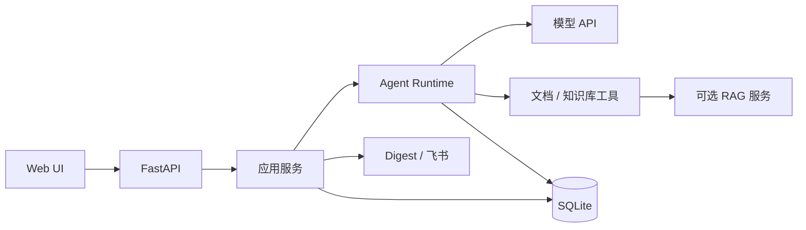

# AI Learning Agent v3 架构设计

> 版本：3.3.1
>
> 定位：单用户、本机运行的个人 AI 学习助手
>
> 原则：核心链路优先，外部依赖可关闭，架构复杂度与个人使用规模匹配

## 1. 目标

v3 只解决四件事：

1. 阅读用户指定的技术文档，并给出带真实来源的回答；
2. 围绕文档和已收藏资料进行连续对话；
3. 每天从可信 AI 来源生成一份资讯摘要并推送到飞书；
4. 从资讯形成笔记、闪卡和简单复习计划。

系统默认只在本机运行，不提供多用户、远程 SaaS 或多实例部署。

## 2. 必要需求

| ID | 需求 | 验收方式 |
|---|---|---|
| R1 | 文档问答 | 输入合法 URL，能够抓取正文并回答 |
| R2 | 来源可追溯 | 回答引用编号由服务端校验，不能伪造 |
| R3 | 连续对话 | 对话可创建、切换、查看和删除 |
| R4 | 可选知识库 | 用户明确收藏后异步入 RAG，之后可以检索 |
| R5 | 每日资讯 | 从启用来源抓取、去重、筛选并生成当天 Digest |
| R6 | 飞书推送 | 当天 Digest 只成功推送一次，失败状态可查询 |
| R7 | 学习闭环 | Digest 可生成笔记、闪卡并记录复习结果 |
| R8 | 本地可用 | 配置、数据、迁移、备份和健康检查完整 |

以下能力属于已有辅助功能，不作为 v3 核心验收项：

- 跨对话学习画像；
- 资讯偏好与有用/无用反馈；
- 来源健康状态和启停；
- 自测题。

这些功能可以继续使用，但后续开发不再围绕它们扩张。

## 3. 明确不做

- 多用户、账号、RBAC、公开 SaaS；
- 多实例、多 worker、Celery/Redis、Kubernetes；
- 全网爬虫和自动收藏所有资讯；
- 自动把学习画像注入模型上下文；
- 复杂长期记忆、知识图谱和 GraphRAG；
- 用 LangChain 或 LangGraph 替换现有轻量 Runtime；
- 为个人本地项目引入微服务或分布式事务。

## 4. 总体架构

采用单进程模块化单体：



主要约束：

- Web UI、API 和后台任务运行在同一个 FastAPI 进程；
- SQLite 保存对话、运行、Digest、画像和学习记录；
- RAG 是可选外部服务，只通过 HTTP 访问；
- 模型 API 是必需依赖；
- Digest 默认关闭，飞书未配置时不影响文档问答；
- 只支持单实例，避免后台任务重复执行。

## 5. 模块职责

| 模块 | 职责 |
|---|---|
| `web/` | 对话页、学习工作台和 API 调用 |
| `api/` | 路由、请求/响应结构和 HTTP 错误映射 |
| `application/` | 对话、Digest、画像和学习用例编排 |
| `agent/` | 模型与工具循环、上下文预算、引用校验 |
| `models/` | 模型 API 适配 |
| `tools/document/` | URL 校验、抓取、正文提取 |
| `tools/knowledge/` | 知识库入库、状态查询和检索 |
| `digest/` | RSS/Atom 解析、Feed 获取和飞书投递 |
| `persistence/` | SQLite、Repository、迁移和事务 |
| `observability/` | 日志、运行状态和敏感信息脱敏 |

保持简单依赖方向：

```text
web → api → application → agent/tools → 外部服务
                    └──→ persistence → SQLite
```

不为每个 Store 强制增加接口层；只有在确实需要替换实现或编写隔离测试时再抽出 Protocol。

## 6. 核心流程

### 文档问答

```text
用户发消息
→ 创建 Run
→ 加载最近历史和已抓取文档
→ 模型调用 fetch_document
→ URL 校验、抓取、正文提取
→ 模型回答
→ 校验引用
→ 保存回答和运行结果
```

### 知识库

```text
用户明确收藏
→ 提交 RAG 入库任务
→ 保存 job_id
→ 后台查询任务状态
→ 完成后写入通知
```

知识库不可用时，文档问答仍可使用。

### 每日资讯

```text
启动后检查当天任务
→ 抓取启用的 RSS/Atom
→ 按 URL 去重
→ 规则筛选和排序
→ 生成 Digest
→ 推送飞书
→ 记录结果
```

### 学习闭环

```text
Digest 条目
→ 生成带来源笔记
→ 生成闪卡
→ 查询到期闪卡
→ 用户提交复习结果
→ 更新下次复习时间
```

## 7. 数据与一致性

- SQLite 是 Agent 侧权威数据源；
- RAG 是独立外部数据源，两侧不做分布式事务；
- 同一对话最多一个活动 Run，由数据库唯一约束保证；
- RAG 入库使用幂等键，通知使用唯一 `job_id`；
- 每个日期只有一份 Digest，同一渠道只保留一条投递记录；
- SQLite 使用外键、WAL 和 `busy_timeout`；
- 数据库变更通过 Alembic，升级前支持备份。

## 8. 安全与运行约束

- 默认只绑定 `127.0.0.1`，远程访问必须经过认证代理或 VPN；
- 外部 URL 只允许 HTTP(S)，拒绝凭据、私网、回环和云元数据地址；
- 每次重定向重新校验目标，限制超时、体积、端口和跳转次数；
- 文档、RSS 和知识库证据一律视为不可信内容；
- 模型工具必须预注册，参数必须通过 Schema 校验；
- 密钥只从环境变量读取，不写入源码、日志或响应；
- 模型轮数、工具次数、输入长度和上下文 Token 均有上限；
- 只运行一个应用实例，不使用多 worker。

## 9. 运维

- `/health/live` 检查进程存活；
- `/health/ready` 检查数据库和必要配置；
- 启动时执行 Alembic，恢复中断 Run；
- 关闭时停止后台任务并释放外部 HTTP 客户端；
- 支持本机运行和 Docker Compose；
- 备份 SQLite；RAG 数据由 RAG 项目单独备份。

## 10. 已知简化边界

- RAG 只有 `default` 总库，不做主题隔离；
- Digest 摘要直接使用 RSS/Atom 内容，不调用模型；
- 笔记和闪卡使用确定性规则生成；
- 学习画像只保存和展示，不注入模型上下文；
- 后台任务依赖单一进程，进程退出后任务停止；
- 真实 RSS、飞书、RAG 和 Docker 验证需要在目标环境手工完成。

## 11. 最小验收

- 能从一个合法 URL 获得带来源的回答；
- 能在同一对话中继续追问；
- 同一对话不能同时运行两个任务；
- 能手动收藏资料并在 RAG 可用时检索；
- 能生成当天 Digest 并成功推送到飞书；
- 能从 Digest 生成笔记和闪卡，并提交一次复习；
- 重启后对话、Digest 和学习记录仍存在；
- 危险 URL、提示词注入和密钥泄露检查通过；
- 离线测试、Ruff、前端检查、锁文件和数据库迁移通过。

## 12. 决策记录

现有架构决策继续有效：

- [模型适配](adr/0001-model-provider.md)
- [HTML 提取](adr/0002-html-extraction.md)
- [SQLite 与迁移](adr/0003-persistence-and-migrations.md)
- [Agent 评估](adr/0004-agent-evaluation.md)
- [异步运行](adr/0005-async-run-execution.md)
- [知识库集成](adr/0006-knowledge-base-integration.md)

安全与发布信息见：

- [威胁模型](threat-model.md)
- [验收记录](verification-log.md)
- [发布检查清单](release-checklist-v3.3.md)
