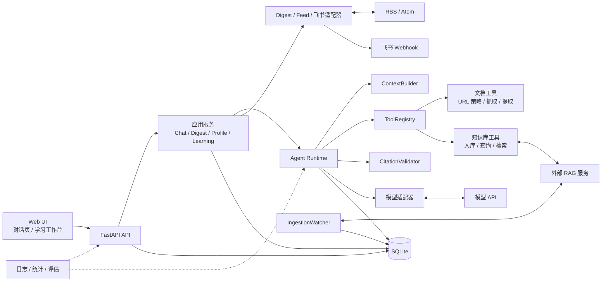

# AI Learning Agent v3 架构设计

> 版本：3.3.1
>
> 状态：v3 功能与安全修订完成，真实外部环境验收待执行
>
> 项目形态：单用户、本机优先、模块化单体
>
> 技术基线：Python 3.12、FastAPI、SQLAlchemy、SQLite、Alembic

## 文档目的

本文定义 v3.3.1 应满足的产品需求、已交付功能、组件边界、数据流、运行约束、
安全边界和验收标准，并记录当前实现与目标架构之间的已知差距。

本文是 v3 的架构基线：

- “应满足”描述 v3 必须达到的能力与质量约束；
- “已具备”描述当前 v3.3.1 代码已经提供的功能；
- “已知债务”描述不能通过架构文档掩盖的实现差距；
- 未纳入当前版本的长期记忆、上下文注入、多用户和分布式能力不属于本文范围。

## 产品定位

v3 是一个在本机运行的个人 AI 学习助手，负责四类连续任务：

1. 根据用户指定或已收藏的资料回答问题，并给出可追溯来源；
2. 从可信来源获取每日 AI 资讯，形成 Digest 并推送到飞书；
3. 从成功对话中提取结构化学习画像，保留主题、概念和薄弱信号证据；
4. 将资讯转化为笔记、自测题、闪卡和复习记录，形成可执行的学习闭环。

系统不追求无人值守的全网学习，也不允许模型自由写入知识库、修改画像或执行配置操作。
外部内容只作为不可信数据使用，用户明确操作才产生长期副作用。

## 需求基线

### 产品需求

| ID | 必须满足的用户需求 | v3 验收口径 |
|---|---|---|
| R-01 | 能阅读指定技术文档并解释内容 | 输入合法 URL 后能抓取、提取正文并返回有来源的回答 |
| R-02 | 回答不能伪造引用 | 引用编号和链接由服务端校验，失效引用必须移除并提示 |
| R-03 | 能进行连续多轮对话 | 对话可创建、切换、查看和删除，历史在预算内进入上下文 |
| R-04 | 长运行不能锁死浏览器请求 | 支持同步等待和异步提交后轮询两种模式 |
| R-05 | 能选择性地长期收藏知识 | 用户明确收藏后才异步入 RAG，完成后可检索 |
| R-06 | 每天获得可信 AI 资讯 | 从启用来源抓取、去重、筛选、排序并生成当日 Digest |
| R-07 | Digest 能按个人偏好推送 | 可按主题、来源、条数和补发天数配置，并通过飞书投递 |
| R-08 | 能控制资讯来源质量和异常 | 可查看最近检查时间与错误，可启停来源和提交反馈 |
| R-09 | 学习状态可跨对话积累 | 成功运行后可记录主题、概念、薄弱信号和证据 |
| R-10 | 用户能纠正学习画像 | 可修改主题状态、概念掌握度、删除主题、清空或关闭画像 |
| R-11 | 资讯能转化为学习行动 | 可生成带来源笔记、自测题和闪卡，并按复习结果安排下次复习 |
| R-12 | 日常操作无需直接调用 API | 对话页与学习工作台覆盖主要日常操作 |
| R-13 | 数据可恢复、问题可定位 | 有迁移、备份、恢复、健康检查、运行记录和统计 |
| R-14 | 默认配置不能意外泄露或越权 | 默认只绑定回环地址，外部内容、URL、日志和密钥均有安全边界 |

### 已具备的功能

| 能力域 | v3.3.1 功能 |
|---|---|
| 对话与运行 | 多对话；同步/异步运行；单对话单活动运行；运行状态、耗时、Token、成本和错误查询 |
| 文档阅读 | 安全 URL 校验；逐跳重定向校验；正文/章节提取；内容清洗；哈希；快照复用；截断标记 |
| Agent 工具 | `fetch_document`；可选 `ingest_urls`、`get_ingestion`、`list_sources`、`search_knowledge` |
| 引用与上下文 | 系统 Prompt；历史与文档 Token 预算；本次问题优先；服务端来源编号；无效引用清理 |
| 知识库联动 | 异步入库；任务轮询；确定性完成通知；来源列表；证据检索；相似度门槛；可选降级 |
| 每日资讯 | 来源注册表；默认官方来源；RSS/Atom 抓取；URL 去重；主题筛选；Top N；Feed 自带摘要 |
| 资讯控制 | 手动触发；当天启动检查；补发窗口；主题/来源/条数偏好；有用/无用反馈；来源健康与启停 |
| 推送 | 飞书 Webhook；签名；有限重试；投递状态；按日期幂等 |
| 学习画像 | 规则提取主题、概念和薄弱信号；证据与置信度；用户校正优先；开关、删除和清空 |
| 学习闭环 | Digest 生成带来源笔记；确定性自测题与闪卡；到期复习队列；复习间隔调整；学习进度统计 |
| Web UI | 对话页；Digest 与反馈；资讯偏好；来源健康；知识库收藏；笔记、自测、复习和画像管理 |
| 运维 | `/health/live`；`/health/ready`；结构化日志；运行统计；Alembic；备份/恢复；Docker |

### 非功能需求

| ID | 约束 |
|---|---|
| N-01 安全 | 所有外部抓取执行协议、凭据、端口、DNS、公网地址、重定向、体积和超时校验 |
| N-02 隔离 | 外部文档、RAG 证据和 Feed 内容不能改变系统指令，不能绕过工具 Schema 执行操作 |
| N-03 可靠性 | 外部依赖失败时给出安全错误；知识库降级不得阻断文档阅读；进程中断后释放活动运行 |
| N-04 一致性 | SQLite 内部写操作使用事务；RAG 与 Agent 不假设分布式事务，靠幂等键和状态记录保持最终一致 |
| N-05 资源控制 | 模型轮数、工具次数、输入长度、上下文 Token、HTTP 超时和响应体积均有上限 |
| N-06 可恢复性 | Schema 通过 Alembic 演进；SQLite 可在线备份和恢复；数据卷不随容器停止而删除 |
| N-07 可维护性 | 模块职责清晰；依赖方向稳定；外部适配器可替换；关键路径有自动化测试 |
| N-08 可解释性 | 引用来源、运行状态、错误分类、Digest 来源和学习证据可追踪 |
| N-09 可移植性 | 本机 Python 与 Docker Compose 均可运行；外部 RAG、模型和飞书可独立启停 |
| N-10 单实例约束 | 同一个 SQLite 数据目录只允许一个应用实例；不支持多进程 worker 共享后台调度 |

### 明确不承担的职责

- 多用户、账号体系、RBAC 和公开 SaaS；
- Kubernetes、多实例调度、Celery/Redis 或分布式事务；
- 全网无边界爬取和自动把所有资讯写入知识库；
- 让模型自由增删来源、修改画像或执行未注册工具；
- 把学习画像自动注入模型上下文；
- 完整长期记忆的版本、冲突、TTL 和跨存储物理删除治理；
- GraphRAG、知识图谱、视频和音频处理；
- 将外部 Digest 摘要视为已经事实核验的权威结论。

## 总体架构

v3 采用模块化单体。Web UI、API、Agent Runtime、后台任务和持久化装配运行在同一个
FastAPI 进程中；RAG、模型、Feed 和飞书通过外部适配器访问。



架构原则：

1. **本机优先**：默认只绑定 `127.0.0.1`，不内置远程认证。
2. **模块化单体**：按业务能力分包，不引入独立服务边界以外的分布式复杂度。
3. **SQLite 为 Agent 权威数据源**：对话、运行、Digest、画像和学习记录以本地数据库为准。
4. **RAG 为可选外部数据源**：Agent 不直接访问 RAG 的 SQLite 或 Chroma。
5. **外部内容不可信**：文档、Feed、知识库证据和模型输出均不能成为系统指令。
6. **副作用显式化**：写入知识库、选择来源和修改画像由用户命令或明确工具触发。
7. **先确定性后模型化**：Digest 摘要、笔记、自测题和闪卡优先使用可解释、可复现规则。
8. **失败安全**：无法确认安全性或一致性时拒绝执行，并保留错误分类与可恢复状态。

## 组件与数据流

当前系统由 Web、API、应用服务、Agent Runtime、外部适配器和 SQLite 组成。RAG 是可选
HTTP 依赖；知识库不可用时，文档阅读、Digest 和学习工作台仍可启动。

### 组件职责

| 层 | 目录 | 职责 | 不承担 |
|---|---|---|---|
| API | `api/` | 路由、请求/响应 Schema、HTTP 错误映射 | 模型循环、SQL |
| 应用 | `application/` | 提交消息、协调对话与运行 | HTML 解析、模型协议 |
| Agent | `agent/` | Runtime、上下文预算、Prompt、工具注册、引用校验 | 抓网页、写 SQL |
| 模型 | `models/` | OpenAI 兼容适配器、工具调用与用量解析 | 对话业务 |
| 工具 | `tools/document/` | URL 策略、HTTP 获取、正文提取与规范化 | 生成回答、写业务表 |
| Digest | `digest/` | RSS/Atom 解析、Feed 抓取、来源默认值、飞书投递 | 学习进度、模型上下文 |
| V3 应用 | `application/digest_service.py`、`learning_profile.py`、`learning_workspace.py` | 日报、画像、笔记、自测、闪卡与复习编排 | 直接拼 SQL、渲染 HTML |
| 持久化 | `persistence/` | 引擎、ORM、Repository、迁移入口 | 业务编排 |
| Web | `web/` | 对话页、学习工作台与安全外链渲染 | 业务规则与数据库访问 |
| 观测 | `observability/` | 结构化日志、关联 ID、脱敏 | 判定业务成败 |

### 业务数据所有权

| 业务域 | 拥有的数据 | 核心不变量 |
|---|---|---|
| 对话与运行 | `conversations`、`messages`、`agent_runs`、`tool_calls` | 同一对话同一时间最多一个 pending/running 运行 |
| 文档证据 | `document_snapshots`、`run_sources` | 来源编号只在单次运行有效；回答只可引用已登记来源 |
| 知识库任务 | `ingestion_watches`、消息 `kind`、来源 `provider` | 同一 RAG job 只登记一次；通知不进入模型历史 |
| 每日资讯 | `push_sources`、`push_items`、`push_digests`、`push_digest_items` | Feed URL 唯一；文章 canonical URL 唯一；每个日期只有一份 Digest |
| 推送与反馈 | `push_deliveries`、`push_preferences`、`push_feedback`、`push_item_ingestions` | 同一 Digest/渠道只有一条投递记录；RAG 收藏幂等 |
| 学习画像 | `learning_profile_settings`、`learning_topics`、`learning_concepts`、`learning_events` | 画像结论必须可关联证据；用户校正优先于自动规则 |
| 学习闭环 | `learning_notes`、`learning_note_sources`、`learning_quizzes`、`learning_quiz_questions`、`learning_flashcards`、`learning_reviews` | 每条 Digest 最多一篇笔记；每篇笔记最多一套自测题；闪卡保留来源和复习历史 |

SQLite 保存 Agent 侧权威业务数据。RAG 保存已入库文档、切块和检索索引，是独立权威源；
两侧通过 HTTP 契约、幂等键、任务状态和确定性通知保持最终一致。

### 目标依赖规则

```text
web → api → application → domain
                  ├→ agent → models
                  ├→ tools
                  └→ persistence ports
persistence adapters → domain
external adapters → application/domain contracts
```

必须遵守：

- Web 不访问 Session、Repository 或 Store；
- API 只调用应用服务或受控查询门面，不拼 SQL、不处理数据库异常；
- Agent Runtime 不直接执行 INSERT/UPDATE/DELETE，通过仓储契约持久化运行结果；
- 工具只返回结构化结果，不自行决定用户可见回答；
- Digest 不读取普通聊天上下文；
- 持久化层不决定是否允许抓取、是否推送或画像是否可信；
- RAG、模型和飞书仅通过显式适配器访问。

当前 v3.3.1 已按业务职责分包，但依赖规则尚未完全落地。API 仍存在直接调用具体 Store、
处理数据库冲突异常的情况；应用服务也直接依赖具体 Store。该差距记录在“已知架构债务”中，
后续应通过窄接口和用例门面逐步消除，不进行一次性大重构。

### 文档问答

1. `POST /api/v1/conversations/{id}/messages` → `ChatService` 校验输入与长度。
2. `AgentRuntime.run` 创建运行记录（数据库级「单对话单活动运行」约束）并保存用户消息。
3. `ContextBuilder` 组装系统提示、最近历史与已获取文档（Token 预算内，截断有标记）。
4. 模型请求工具 → `ToolRegistry` 校验注册与参数 → `FetchDocumentTool` 执行：
   `UrlPolicy`（白名单/协议/端口/DNS 公网校验）→ `DocumentFetcher`（逐跳重定向、对端地址校验、
   体积与超时限制）→ `extractor`/`normalizer`（正文、章节、哈希、截断）。
5. 结果写入 `document_snapshots` 与 `run_sources`，工具调用摘要写入 `tool_calls`。
6. 最终回答经 `CitationValidator` 校验引用与链接，保存助手消息并结束运行。

失败路径：任何阶段失败都会写入 `error_code`/`error_category`，运行状态置为 `failed`，
API 返回安全错误结构与 `run_id`。

### 每日 Digest

1. `DigestScheduler` 在启动或手动触发时调用 `DailyDigestService`。
2. 启用来源经 `FeedFetcher` 按来源域名执行 URL 策略和抓取限制。
3. `parse_feed` 解析 RSS/Atom，文章链接必须通过
   `domain/urls.normalize_external_url`，仅允许 HTTP(S)。
4. `push_items` 按 canonical URL 去重；历史非法链接在启动时标记为 `quarantined`。
5. `PushDigest` 和 `PushDigestItem` 保存当天排序结果与摘要。
6. `FeishuNotifier` 投递，`push_deliveries` 保存成功或安全失败分类。

当前 v3.3.1 使用 Feed 自带摘要，不调用模型生成摘要。批量模型摘要、条件请求、
robots.txt 和紧急停止不纳入当前架构基线。

### 学习画像与学习闭环

- `LearningProfileService` 从成功完成的用户消息中提取主题、概念和薄弱信号。
- `learning_topics`、`learning_concepts`、`learning_events` 保存结构化证据；
  用户校正优先于自动规则。
- `LearningWorkspaceService` 从 Digest 生成带来源笔记，并生成确定性自测题和闪卡。
- `learning_reviews` 保存复习历史；`next_review_at` 驱动到期复习队列。
- `GET /api/v1/learning/progress` 聚合笔记、闪卡、留存率和薄弱主题。

v3 只持久化、查看和校正画像，不把画像自动注入模型 Prompt。

## 安全与隐私

### 网络访问策略

| 场景 | 域名与来源策略 | 是否自动入库 |
|---|---|---|
| 用户手动阅读，`trusted_only` | 必须命中 `ALLOWED_DOCUMENT_HOSTS` | 否 |
| 用户手动阅读，`open_public` | 允许公网地址，但拒绝私网、回环、保留地址和元数据端点 | 否 |
| 每日 Digest | 只抓取来源注册表中启用且允许的 Feed | 否 |
| 用户明确收藏 | 来源可信或用户确认后提交 RAG | 是 |

所有 HTTP(S) 抓取必须拒绝 URL 凭据和非 HTTP(S) 协议，限制端口、重定向、超时、响应体
和正文长度，校验全部 DNS 解析结果；每次重定向重新执行完整策略，并校验实际连接对端地址。

### 内容与输出安全

- 所有 RSS/Atom 文章 URL 在解析、持久化和 API 输出时校验。
- `safe-url.js` 在浏览器创建 `href` 前再次限制为 HTTP(S)。
- `api/security_headers.py` 为应用响应设置 CSP、`nosniff`、`no-referrer`、
  `frame-ancestors 'none'` 与权限策略。
- Swagger/ReDoc 路径单独排除严格 CSP，避免破坏框架自带文档资源。
- 文档、RAG 证据和 Feed 内容是外部不可信数据；
- 工具只能来自静态注册表，参数先通过 Pydantic Schema；
- 来源编号和展示链接由服务端生成，模型不能伪造；
- 错误响应不包含堆栈、SQL、内部 URL 或密钥。

### 密钥与本地边界

- 模型、RAG 和飞书密钥只从环境变量读取；
- `.env`、数据库、备份和日志按敏感数据处理；
- 日志不记录完整用户消息、密钥或包含敏感查询参数的 URL；
- 应用与 RAG 没有应用级认证，必须只绑定回环地址或受信网络；
- 远程访问必须置于认证的 HTTPS 反向代理或 VPN 之后。

## 知识库边界与一致性

| 模块 | 职责 | 不承担 |
|---|---|---|
| `tools/knowledge/client.py` | 调用 RAG 的入库、任务查询、来源与检索接口；超时、有限重试与错误映射 | 抓取网页、写入 RAG 数据库 |
| `tools/knowledge/tool.py` | 四个工具的 Schema、参数校验、结果压缩与来源登记 | 生成回答、持久化通知 |
| `application/ingestion_watcher.py` | watch 登记、退避轮询、终态通知、旧 watch 清理 | 调用 LLM、修改知识库 |
| `persistence/*` | `ingestion_watches`、消息 `kind`、来源 `provider` | 判断业务成败 |

数据流：

1. **入库**：用户消息 → 模型调用 `ingest_urls` → RAG 创建 job → 登记 watch →
   返回 `job_id`。链接不落 Agent 侧正文库。
2. **通知**：watcher 轮询 job → 终态写入 `kind=ingestion_notice` 的 assistant 消息 →
   标记 `notified_at`。通知不进入模型上下文。
3. **检索**：模型调用 `search_knowledge` → RAG 返回证据片段 → 相似度门槛 →
   登记 `provider=knowledge_base` 的来源 → 引用校验 → 持久化回答。

边界：RAG 是可选外部依赖，通过 HTTP 契约集成；两套数据库不做分布式事务，
入库用幂等键、通知用唯一 `job_id` 保证重复安全。

## 并发、事务与一致性

- SQLite 启用外键、WAL 和 `busy_timeout`；
- 对话 Run、用户消息和状态更新尽量合并为少量事务；
- 默认同步模式在请求内等待最终结果；异步模式先创建活动 Run 并返回 `run_id`；
- `RunScheduler` 持有后台任务引用，关闭时等待在途任务；
- 活动运行约束由数据库部分唯一索引保证，应用层只负责映射错误；
- 进程中断遗留的 pending/running Run 在下次启动时标记为 `run_interrupted`；
- `AsyncRepositories` 通过线程池隔离阻塞 SQLAlchemy 调用；
- RAG 和 Agent 数据库之间不使用分布式事务；
- 入库、Digest、收藏和通知通过唯一约束与幂等键防止重复；
- Digest 与后台 watcher 只支持单进程实例；多 worker 会重复调度，因此不受支持；
- 代码修改不得削弱数据库级不变量，不能只依赖“先查询再写入”的应用层检查。

## 可观测性与运维

### 可观测性

- 每次 Run 使用 `run_id` 与 `conversation_id` 关联日志；
- 记录运行状态、模型轮数、工具调用、耗时、Token、成本和安全错误分类；
- 统计接口提供运行成功/失败、p50/p95、知识库失败率、超时率和 watch 积压；
- Digest 记录来源健康、生成状态、投递次数和失败分类；
- 关键业务链使用离线测试、假外部依赖集成测试和评估集。

### 启动与关闭

启动顺序：

1. 校验必要配置；
2. Alembic 升级数据库；
3. 按配置初始化默认来源；
4. 隔离历史非法 Digest 链接；
5. 恢复中断 Run；
6. 注册工具、应用服务和路由；
7. 启动 DigestScheduler 与 IngestionWatcher。

关闭顺序：

1. 停止调度器；
2. 等待或取消后台任务；
3. 等待在途 Run 调度器退出；
4. 关闭模型、RAG 和飞书 HTTP 客户端；
5. 释放数据库引擎。

### 部署与数据管理

- 本机可直接运行 Uvicorn，也可通过 Docker Compose 运行；
- Compose 只把端口绑定到 `127.0.0.1`；
- `./data` 是 SQLite 持久化目录；
- RAG 可运行在宿主机 `8001`，通过稳定 HTTP 契约访问；
- 只允许一个应用实例，不使用多 worker；
- Schema 变更必须通过 Alembic，不使用启动时 `create_all` 代替迁移；
- 升级前必须可备份 SQLite，备份和恢复脚本执行完整性与行数校验；
- RAG 数据按 RAG 项目自己的备份策略管理，恢复顺序为 RAG 后 Agent。

## 已知架构债务

| ID | 问题 | 影响 | 建议 |
|---|---|---|---|
| A-01 | API 路由直接依赖具体 `V3Store`，部分来源校验和业务编排位于路由 | API 层承担持久化细节，替换和测试成本上升 | 将用例移入应用服务，API 保留 HTTP 映射 |
| A-02 | 应用服务直接依赖具体 Store；`ChatService` 使用 `object`，Runtime 使用 `Any` | 类型约束和可替换性不足 | 为实际使用的方法定义窄 Protocol |
| A-03 | `AsyncRepositories` 只覆盖对话/Run 存储，V3 与学习 Store 仍在 async 路径同步访问 | 并发时可能阻塞事件循环 | 为 V3 查询和写操作增加异步门面或统一线程池边界 |
| A-04 | `V3Store`、`LearningStore` 和 `Repositories` 体积较大且混合多个子域 | 变更影响面较大 | 按 Digest、Profile、Learning、Conversation 渐进拆分 |
| A-05 | 安全响应头安装存在重复调用 | 重复中间件和无效开销 | 删除重复装配并增加装配测试 |
| A-06 | RAG 只有单总库 `default`，没有应用级鉴权 | 无法做真实主题隔离，跨主机不安全 | 保持回环/受信网络限制；collection 与鉴权由 RAG 能力边界解决 |
| A-07 | Digest 与 watcher 是进程内后台任务 | 多实例会重复执行，进程退出会停止任务 | 维持单实例；需要多实例时先引入独立调度与锁 |
| A-08 | 部分预留字段尚未接线，真实外部集成验收未完成 | 文档容易误报已具备能力 | 未实现能力不得写入完成项；发布前完成手工冒烟 |

## 验收标准

### 功能验收

- 用户能从合法 URL 获得带服务端来源的文档回答；
- 同一对话已有活动运行时，第二次提交被拒绝且不写入新消息；
- Run 失败、超时、工具失败和进程中断均能如实反映；
- 用户可异步入库并收到确定性通知，知识库证据可被检索和引用；
- 同一 RSS 条目、同一天 Digest 和同一收藏任务不会重复产生；
- Digest 的偏好、反馈、来源健康、启停和补发可恢复；
- 画像跨两个对话能识别同一主题，用户校正不会被自动覆盖；
- Digest 能生成带来源笔记、自测题、闪卡和到期复习记录；
- `/study.html` 可完成主要日常操作，刷新与重启后状态保留。

### 质量验收

- 离线测试、格式检查、Lint、前端语法、前端安全单测和锁文件检查通过；
- 危险协议、凭据 URL、SSRF、重定向越界和提示词注入用例通过；
- 旧数据库可迁移，备份与恢复后行数一致；
- 密钥、完整消息和内部异常不进入日志或 API 响应；
- 真实模型、真实 RSS、真实飞书、真实 RAG 入库和 Docker 联合运行必须在发布环境
  单独完成，不由离线测试替代。

## 关键设计决策

- [ADR 0001：模型供应商适配](adr/0001-model-provider.md)
- [ADR 0002：HTML 提取](adr/0002-html-extraction.md)
- [ADR 0003：持久化与迁移](adr/0003-persistence-and-migrations.md)
- [ADR 0004：Agent 评估](adr/0004-agent-evaluation.md)
- [ADR 0005：异步运行与异步数据访问](adr/0005-async-run-execution.md)
- [ADR 0006：知识库集成](adr/0006-knowledge-base-integration.md)

安全残余风险和发布证据分别见：

- [威胁模型](threat-model.md)
- [验收与演练记录](verification-log.md)
- [V3.3 发布检查清单](release-checklist-v3.3.md)
