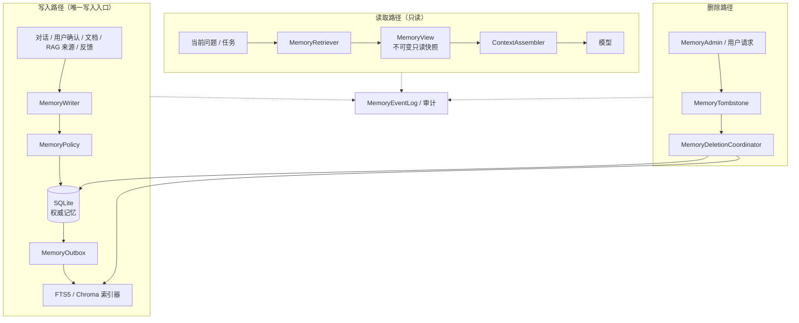

# AI Learning Agent v4.0 项目说明书

> 文档用途：V4 长期记忆工程与上下文工程的架构、接口、生命周期和实施基线。
> 版本：4.0
> 状态：架构设计基线，待开发
> 前置版本：v3.0（每日资讯、学习画像基础、知识库工具）
> 核心主题：**可控长期记忆 + 只读上下文工程**。

## 0. 版本定位

v3.0 解决的是“能持续获取资讯、记录学习画像”；
v4.0 解决的是“这些信息如何被可靠写入、更新、检索、压缩和删除”。

本版本不把所有对话直接塞进向量库。长期记忆必须是可审计、可纠正、可版本化、
可物理删除的事实数据；上下文只是对这些事实的一次读取视图。

### 0.1 v4 必须回答的问题

1. 什么内容有资格成为长期记忆？
2. 相同或冲突的记忆如何合并、保留和纠正？
3. 一条记忆被更新后，旧版本如何退出检索？
4. 用户要求遗忘时，如何从 SQLite、FTS5、Chroma、快照和缓存中物理删除？
5. 本轮对话应该读取哪些记忆，如何控制 Token 和来源多样性？
6. 写入路径和读取路径如何做到严格解耦？
7. 哪些工作流适合交给 LangGraph/LangChain，哪些必须留在项目自己的领域层？

### 0.2 v4 范围原则

- 单用户、本机优先，暂不做多用户隔离。
- RAG 仍是外部知识库服务；v4 不重写 RAG 检索主链路。
- SQLite 是 Agent 的权威数据源；FTS5 与 Chroma 是派生索引。
- 记忆内容是不可信数据，不等同于系统指令。
- 模型不能自由创建、修改或删除长期记忆；必须经过明确的命令或用户确认。
- 任何物理删除都必须可验证，不能只删除一张表。

## 1. 当前基础与缺口

### 1.1 v3 已有

- 对话历史：`conversations`、`messages`；
- 运行与工具审计：`agent_runs`、`tool_calls`；
- 文档/证据快照：`document_snapshots`、`run_sources`；
- RAG 知识库：来源、切块、FTS5、Chroma；
- 学习画像基础：`learning_topics`、`learning_concepts`、`learning_events`；
- 通知和 Digest 状态：`ingestion_watches`、`push_*`；
- 上下文预算：`ContextBuilder`、`MAX_HISTORY_MESSAGES`、`CONTEXT_MAX_TOKENS`。

### 1.2 v3 缺口

- 没有统一的 `Memory` 领域对象和生命周期状态机；
- 没有跨层的记忆版本、冲突、去重和物理删除协调器；
- 画像只持久化、只读 API，尚未注入上下文；
- 对话超过历史/Token 预算时直接省略，不做滚动摘要；
- SQLite、FTS5、Chroma、快照和缓存的删除不是统一事务；
- 没有 Memory 写入与上下文使用的明确接口边界；
- 没有记忆质量、遗忘和删除审计；
- 没有框架适配层，未来迁移容易侵入 Runtime 和 Repository。

## 2. 记忆分类

| 类型 | 内容 | 生命周期 | 是否进入上下文 |
| --- | --- | --- | --- |
| 工作记忆 | 当前问题、当前工具结果、当前任务状态 | 单次 Run | 是 |
| 情节记忆 | 对话消息、对话摘要、用户重要操作 | 会话级/长期 | 按需 |
| 语义记忆 | 用户确认入库的文档、概念和事实 | 长期 | 按需 |
| 学习画像 | 主题、概念、薄弱点、复习状态 | 长期 | 画像摘要 |
| 审计记录 | Run、工具调用、Token、错误 | 保留期 | 否 |
| 操作状态 | Digest、入库 watch、投递状态 | 操作域 | 否 |

### 2.1 不应成为长期记忆的内容

- `ingestion_notice` 等确定性通知；
- 工具失败堆栈和原始错误；
- 未确认的模型猜测；
- 每日 Digest 中的全部低置信度资讯；
- 临时工具结果和重复抓取的 HTML；
- 日志、密钥、请求头和完整敏感 URL 查询串。

## 3. 总体架构



### 3.1 组件职责

| 组件 | 唯一职责 | 明确不负责 |
| --- | --- | --- |
| `MemoryWriter` | 接收候选记忆，完成规范化、去重、冲突和版本决策 | 回答用户问题 |
| `MemoryPolicy` | 来源可信度、用户授权、保留期、冲突优先级 | 直接写库 |
| `MemoryStore` | SQLite 权威记录和版本读取 | 生成上下文 |
| `MemoryOutbox` | 解耦关系库提交与派生索引更新 | 业务规则 |
| `MemoryIndexer` | 写 FTS5/Chroma，保证幂等 | 决定记忆是否有效 |
| `MemoryRetriever` | 只读检索 active 版本并返回证据 | 写记忆 |
| `MemoryView` | 不可变读取视图，带版本、来源和置信度 | 修改数据库 |
| `ContextAssembler` | 选择、排序、压缩和注入 MemoryView | 写入或删除记忆 |
| `MemoryDeletionCoordinator` | tombstone、跨存储物理清理、删除验证 | 业务问答 |
| `MemoryAdmin/API` | 用户查看、纠正、遗忘、导出和恢复 | 直接操作索引 |

### 3.2 写入与使用严格解耦

- 写入只通过 `MemoryWriter`；
- 检索只通过 `MemoryRetriever`；
- 上下文只通过 `ContextAssembler`；
- `ContextAssembler` 接收 `MemoryView`，不接收 ORM Session；
- Runtime 不直接执行 INSERT/UPDATE/DELETE；
- 模型不能自由调用“写入长期记忆”工具，只能触发明确的用户命令；
- 记忆写入成功后通过 Outbox 异步更新索引，禁止 SQLite 与 Chroma 双写；
- 检索只读取 `active` 版本，不读取 `candidate`、`superseded`、`tombstoned`；
- 上下文构建不对记忆做任何修改。

## 4. 数据模型

### 4.1 `memory_records`

权威记忆身份和当前状态：

| 字段 | 说明 |
| --- | --- |
| `id` | Memory ID |
| `kind` | `episodic` / `semantic` / `profile` |
| `owner_id` | 单用户暂为 `local` |
| `canonical_key` | 去重键 |
| `current_version` | 当前 active 版本 |
| `status` | `candidate` / `active` / `superseded` / `tombstoned` |
| `created_at` / `updated_at` | 时间 |
| `deleted_at` | tombstone 时间 |

### 4.2 `memory_versions`

不可变版本：

| 字段 | 说明 |
| --- | --- |
| `memory_id` + `version` | 联合主键 |
| `title` / `summary` / `content` | 可控正文 |
| `content_hash` | 内容哈希 |
| `source_type` / `source_ref` | 对话、文档、RAG、用户纠正 |
| `confidence` | 置信度 |
| `valid_from` / `valid_to` | 生效时间 |
| `supersedes_id` | 被替代版本 |
| `status` | `candidate` / `active` / `superseded` |
| `created_by` | `rule` / `user` / `import` |

### 4.3 `memory_events`

追加式审计事件：

- `candidate_created`
- `deduplicated`
- `conflict_detected`
- `version_created`
- `activated`
- `superseded`
- `user_corrected`
- `tombstoned`
- `physically_deleted`

事件至少记录 `memory_id`、`version`、来源、操作者、原因、时间和 request/run ID。

### 4.4 `memory_outbox`

用于可靠派生索引：

- `event_id`
- `memory_id`
- `version`
- `operation`：`upsert` / `delete`
- `status`：`pending` / `processing` / `done` / `failed`
- `attempts`
- `next_retry_at`
- `last_error`

SQLite 事务提交和 Outbox 写入必须同一个事务；索引器至少一次消费，按
`(memory_id, version, operation)` 幂等。

### 4.5 `memory_tombstones`

物理删除任务：

- `memory_id`
- `requested_at`
- `requested_by`
- `reason`
- `status`：`pending` / `purging` / `verified` / `failed`
- `purge_targets`
- `verified_at`

### 4.6 `conversation_summaries`

可选表，用于对话滚动摘要：

- `conversation_id`
- `from_message_id` / `to_message_id`
- `summary`
- `token_count`
- `created_at`
- `version`

原始消息仍保留在 `messages`；摘要只是派生记忆，不替代原始记录。

## 5. 生命周期

### 5.1 状态机

```text
candidate
  → normalized
  → active
  → superseded
  → tombstoned
  → physically_deleted
```

允许异常路径：

- `candidate → rejected`：来源不可信、内容为空或用户未授权；
- `active → conflict`：冲突未解决，保留多个版本但检索时标记；
- `tombstoned → leaked`：物理清理失败，进入人工/重试队列。

### 5.2 写入流水线

```text
候选内容
→ 来源校验
→ 规范化
→ 精确去重（canonical key + content hash）
→ 语义去重（同 kind 内 fingerprint）
→ 冲突检测
→ 版本决策
→ SQLite 事务 + Outbox
→ 异步 FTS/Chroma 索引
→ 审计事件
```

写入必须带 `idempotency_key`，重复请求返回已有 Memory ID。

### 5.3 去重

去重只在相同 `kind` 和 `owner_id` 内进行：

- 精确去重：canonical URL、来源 ID、内容哈希；
- 近重复：标题、摘要、语义指纹和相似度阈值；
- 用户显式纠正不参与自动合并，必须产生新版本；
- 不同主题/不同来源的相似内容不直接合并，保留来源差异。

### 5.4 冲突消解

优先级建议：

1. 用户明确纠正；
2. 官方/一手来源；
3. `verified` 可信来源；
4. `trusted` 来源；
5. 模型推断或社区内容。

无法自动消解时：

- 两个版本都保留；
- `memory_records.status=conflict` 或在版本上标记冲突；
- 检索返回最高可信版本并附带冲突警告；
- 等待用户确认，不允许静默覆盖。

### 5.5 版本更新

- active 内容不可变；
- 新内容创建新 `memory_versions`；
- 新版本记录 `supersedes_id`；
- 旧版本变为 `superseded`，保留审计；
- 检索只返回当前 active 版本；
- 版本回滚创建新版本，不直接修改历史。

### 5.6 物理删除

删除分两阶段：

1. **立即 tombstone**：检索立即不可见；
2. **异步物理清理**：
   - SQLite 记录和版本；
   - FTS5 索引；
   - Chroma 向量；
   - 文档快照；
   - 缓存；
   - Outbox/待处理索引任务；
   - 按备份保留策略清理备份。

删除完成后必须执行验证：

- 按 Memory ID 无法检索；
- FTS/Chroma 无对应 ID；
- 快照/缓存无对应内容；
- 删除事件和验证结果写入审计。

备份不等于物理删除：必须定义备份保留期和到期清理策略。

### 5.7 保留、遗忘和用户控制

- 每类记忆有独立 TTL/保留策略；
- 用户可查看、纠正、遗忘单条记忆；
- 用户可关闭某类记忆写入；
- 关闭后不新增，但已有记录按删除策略处理；
- 记忆内容不得包含密钥、密码和完整敏感查询串。

## 6. 上下文工程

### 6.1 ContextAssembler 输入

- 当前用户问题；
- 安全/系统 Prompt；
- 当前任务状态；
- 最近对话消息；
- 对话滚动摘要；
- `MemoryRetriever` 返回的 `MemoryView`；
- 本轮工具结果；
- Token/字符预算和来源多样性配置。

### 6.2 上下文分层优先级

建议从高到低：

1. 系统与安全规则；
2. 当前问题；
3. 当前任务状态；
4. 最近对话；
5. 相关学习画像摘要；
6. 相关长期记忆；
7. 当前文档/工具证据；
8. 较早摘要。

具体顺序可按问题类型调整，但任何 Layer 都必须受独立预算约束。

### 6.3 读取规则

- 只读 active/有效版本；
- 每块记忆带 `memory_id`、`version`、来源、置信度和时间；
- 同一事实只出现一次；
- 来源多样性不足时提示，而不是重复同一来源；
- 低置信度/冲突记忆必须标记；
- 记忆内容不是系统指令，必须按不可信数据处理；
- 超出预算时记录被省略的记忆和原因。

### 6.4 压缩和摘要

- 对话超过历史/Token 限制时，先分级摘要，再按预算注入；
- 摘要必须保留来源范围和版本；
- 摘要不可覆盖原始消息；
- 摘要失败时回退到最近消息；
- 记忆摘要不能替代引用证据；
- 生成摘要的模型调用需要独立费用和超时限制。

### 6.5 上下文使用审计

每次 ContextBundle 记录：

- 包含哪些 Memory ID/版本；
- 为什么被选中；
- 各层 Token；
- 哪些内容被省略；
- 是否有冲突/低置信/过期内容；
- 实际模型与 Prompt 版本。

这为评估“上下文是否真的帮助回答”提供依据。

## 7. 框架选择

### 7.1 当前建议

**v4.0 先保留 FastAPI + SQLAlchemy + Alembic + 自定义 AgentRuntime。**

原因：

- 现有引用校验、安全策略、错误映射、Repository 和审计链路已经稳定；
- Memory 生命周期需要项目自己的数据契约，框架不应成为权威数据库；
- 一次性迁移 LangChain/LangGraph 会扩大回归面，难以证明删除和版本语义；
- 当前单用户规模不需要分布式工作流引擎。

### 7.2 LangGraph

适合用作 v4 的**编排适配层**：

- Memory 写入多阶段流水线；
- 冲突待确认的人类审批；
- 长任务的 checkpoint/recovery；
- 对话摘要、复习、记忆压缩工作流；
- 以后多步骤学习闭环。

约束：

- LangGraph 只编排 `MemoryWriter`/`MemoryRetriever`/`ContextAssembler`；
- SQLite 仍是事实来源；
- 图状态必须可序列化、可恢复；
- 框架节点不能绕过 MemoryPolicy 直接写库。

### 7.3 LangChain

可作为外围适配器：

- 文档加载器；
- Retriever/Tool/Model adapter；
- 向量库连接器。

不建议让 LangChain 承担：

- 版本更新；
- 物理删除；
- 冲突消解；
- 用户授权；
- Memory 权威存储；
- 跨 SQLite/Chroma 一致性。

### 7.4 框架决策表

| 能力 | v4 首选 | 备选 |
| --- | --- | --- |
| Memory 数据与生命周期 | 项目自有 SQLite/Repository | 不交给框架 |
| Agent 工具循环 | 现有 Runtime | LangGraph 适配 |
| 多阶段记忆工作流 | 自定义状态机，复杂度上升后 LangGraph | LangGraph |
| 文档/模型适配 | 现有适配器 | LangChain adapter |
| RAG 主链路 | 现有 RAG 服务 | 不重写 |
| 调度 | 现有启动触发/轻量后台任务 | APScheduler/LangGraph |

## 8. 接口设计

### 8.1 内部接口

```text
MemoryWriter.write(candidate, idempotency_key) -> MemoryId
MemoryWriter.correct(memory_id, version, user_correction) -> MemoryId
MemoryRetriever.search(query, filters) -> MemoryView[]
MemoryRetriever.get(memory_id, version) -> MemoryView
ContextAssembler.assemble(question, memory_views, ...) -> ContextBundle
MemoryDeletionCoordinator.delete(memory_id, reason) -> DeleteJob
```

### 8.2 用户侧 API

- `GET /api/v1/memory/search`
- `GET /api/v1/memory/{memory_id}`
- `POST /api/v1/memory/{memory_id}/correct`
- `DELETE /api/v1/memory/{memory_id}`
- `GET /api/v1/memory/deletions/{job_id}`
- `GET /api/v1/context/preview`

用户侧 API 只暴露明确操作；模型不能自由调用通用的“写长期记忆”工具。

## 9. 从 v3 迁移

- 保留 v3 的 conversations/messages/snapshots/RAG 来源；
- 将 `learning_topics/concepts/events` 映射为 profile memory；
- 将用户明确入库的 RAG 来源登记为 semantic memory 的 `source_ref`；
- 历史消息不自动变成长期记忆，先生成候选摘要；
- 旧表保留只读迁移窗口，双读校验后再切换；
- 迁移可回滚，迁移前备份 SQLite 与 Chroma；
- 迁移完成后验证旧的引用、画像和知识库查询不回归。

## 10. 安全、隐私和一致性

- 单用户模式仍保留 `owner_id` 字段；
- Memory 内容按不可信数据处理；
- 不在日志中记录完整记忆正文和敏感 URL；
- 用户删除请求立即停止检索；
- 物理删除必须跨存储验证；
- SQLite 与派生索引通过 Outbox 保持最终一致；
- 删除失败进入重试和人工可见告警；
- 备份保留期与用户删除权必须明确区分。

## 11. 测试和验收

### 11.1 单元测试

- 规范化、canonical key、内容哈希；
- 精确/语义去重；
- 冲突优先级；
- 版本 supersede 和回滚；
- 状态机非法迁移；
- Outbox 幂等；
- TTL、保留期和用户开关；
- 删除计划和验证。

### 11.2 集成测试

- 写入 SQLite 后索引最终一致；
- 重复写入只产生一个 Memory；
- 冲突不会静默覆盖；
- active 版本才可检索；
- tombstone 后立即不可检索；
- SQLite/FTS/Chroma/快照/缓存物理清理；
- 备份保留策略；
- v3 数据迁移与回滚；
- Runtime 不能直接写 MemoryStore。

### 11.3 上下文测试

- 预算裁剪；
- 来源多样性；
- 记忆去重；
- 摘要失败回退；
- 上下文审计字段；
- 冲突/低置信记忆标记；
- 记忆内容中的提示注入不影响系统规则。

### 11.4 完成标准

- 写入入口唯一；
- 读取/上下文完全只读；
- 去重、冲突、版本和物理删除都有证据；
- 删除后跨全部存储不可检索；
- 所有用户可见记忆都有来源和版本；
- v3 功能无回归；
- 评估结果和删除演练记录可复现。

## 12. 实施阶段

### v4.0：记忆核心

- Memory 接口、数据表、状态机和迁移；
- MemoryWriter、Policy、Outbox；
- MemoryRetriever、MemoryView；
- 删除协调器和基础审计；
- 先接入学习画像和显式收藏来源。

### v4.1：上下文工程

- 对话滚动摘要；
- 画像/长期记忆注入；
- 分层预算、排序、压缩和来源多样性；
- ContextTrace 和上下文评估。

### v4.2：高级治理

- 语义去重；
- 冲突人工确认；
- 记忆衰减/TTL；
- 记忆质量评估；
- LangGraph 适配器（仅在复杂度证明需要时）。

## 13. 非目标

- 多用户/远程 SaaS/RBAC；
- GraphRAG/知识图谱；
- 视频/音频记忆；
- 用 LangChain/LangGraph 替代权威数据层；
- 自动把全部对话变成长期记忆；
- 自动把全部每日资讯写入 RAG；
- 无审计的“模型自由记忆”。

## 14. 开放决策

1. 用户明确纠正是否直接覆盖 active 版本，还是创建并立即激活新版本？
2. 语义去重相似度阈值和评估集；
3. profile、episodic、semantic 是否共用一张 Memory 主表；
4. TTL 默认值和不同记忆类型的保留期；
5. 物理删除是否包含历史备份，备份保留多久；
6. LangGraph 是否在 v4.1 引入，还是等待工作流复杂度触发；
7. 是否允许模型提出“候选记忆”，但必须用户确认；
8. 上下文预算在问题、历史、画像、语义记忆和工具证据之间如何分配。
